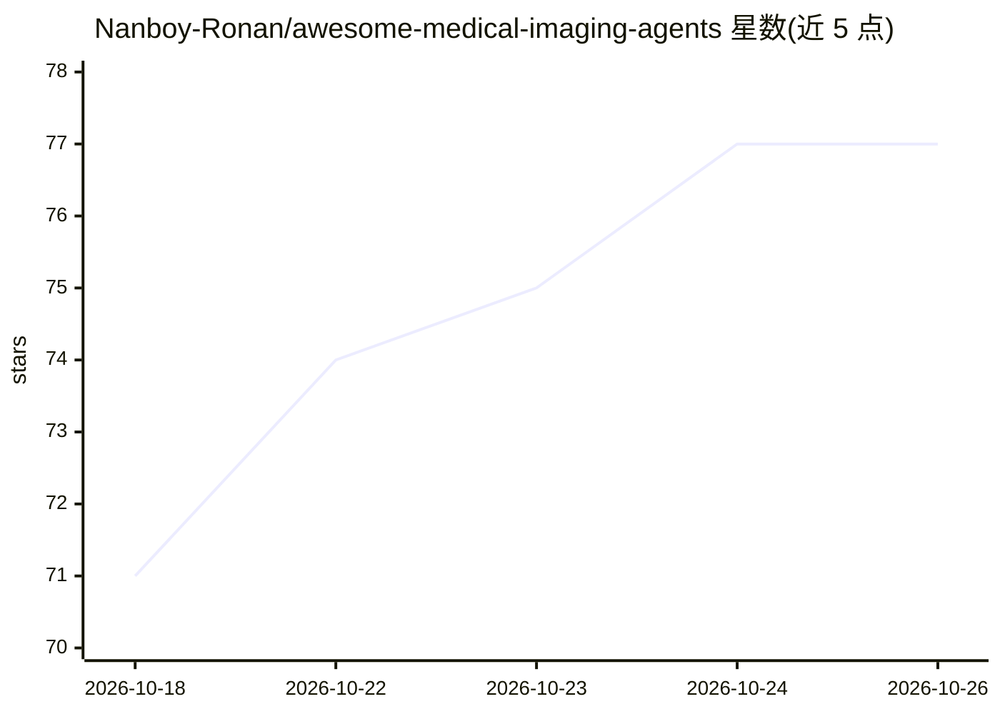

# Nanboy-Ronan/awesome-medical-imaging-agents

⭐ 77 · Python · NOASSERTION · 推送 2026-10-25 · [GitHub](https://github.com/Nanboy-Ronan/awesome-medical-imaging-agents) · 个人维护

**医学影像 AI agent 论文与系统策展清单（放射/病理/超声等）**

策展医学影像领域的 agentic AI 研究资源：收录论文、基准、数据集与开源系统，覆盖放射、病理、超声、内镜、分割、医学 VLM 等 agent 类别，涉及 CT、MRI、胸片、PET 等模态。内容组织含可视化分类树、12 个入门标志性系统表格及按类别的论文列表（如 Radiology Agents 52 条），条目多附年份、方法要点与代码链接。面向从事医学影像 agent 研究的读者。

## 筛选速览

| 维度 | 判定 | 备注 |
|---|---|---|
| AI 角色 | `ai-knowledge` | 知识聚合/清单类 |
| 许可风险 | `none` | NOASSERTION |
| 部署形态 | `None` |  |
| 模型依赖 | — | README 未给出锁定关系 |
| 硬件要求 | — | 无带数字的原话,不猜 |
| 安装摩擦 | `low` | 无编译、无系统依赖或容器化 |
| 成熟度 | — | 结构信号不足 |

## 能力要点

- 收录论文、基准、数据集与开源系统四类资源
- 12 个入门标志性系统覆盖主要子领域
- Radiology Agents 单类即含 52 条条目
- 覆盖 CT/MRI/X 光/超声/病理/内镜/眼科等十余种模态

## 适用场景

- 查找医学影像 agent 领域的代表性论文与代码
- 了解放射、病理、分割等方向的 agent 研究进展
- 寻找该领域的基准与数据集资源

## 场景标签

`精选清单` · 领域:学习与行业

## 证据(README 行号)

> L3: > Agentic AI systems for medical image analysis, including radiology agents, pathology agents, ultrasound agents, su
> L5: This repository curates research papers, benchmarks, datasets, and open-source systems for medical imaging agents. I

## 星数曲线

2026-10-18 71 → 2026-10-26 77（+6）

---
*卡片 v1 · prompt 1.4 · 生成 2026-10-24 · 置信度 high · 依据 README sha `296f3c5b6763` · [字段定义](../../DATASET.md)*
