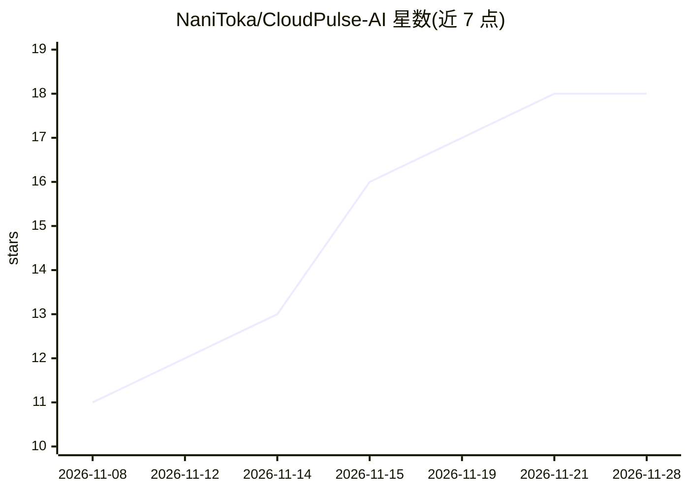

# NaniToka/CloudPulse-AI

⭐ 18 · Python · 推送 2026-10-06 · [GitHub](https://github.com/NaniToka/CloudPulse-AI) · 组织维护

**面向企业的云可观测与 AIOps 平台，含自动事件检测与自愈**

面向 SRE 与云运维团队的可观测平台：整合 OpenTelemetry 分布式追踪、WebSockets 实时指标流、拓扑爆炸半径计算、SLI/SLO 测量、FinOps 成本治理与多租户 RBAC。AI 部分以 Google Gemini 1.5 结合 RAG（ChromaDB 向量库）做自然语言基础设施问答、事件关联、根因分析与预测性异常检测，并提供自动/半自动/手动三档修复工作流。默认以 Demo 模式运行：使用本地确定性 SRE 推理引擎，无需云凭证或 LLM API key。技术栈为 FastAPI + React 18，通过 Docker Compose 部署。

## 筛选速览

| 维度 | 判定 | 备注 |
|---|---|---|
| AI 角色 | `ai-enhanced` | 去掉 AI 部分产品仍成立 |
| 许可风险 | `none` | — |
| 部署形态 | `self-host` | docker 或自建部署 |
| 模型依赖 | — | README 未给出锁定关系 |
| 硬件要求 | — | 无带数字的原话,不猜 |
| 安装摩擦 | `low` | 无编译、无系统依赖或容器化 |
| 成熟度 | — | 结构信号不足 |

## 能力要点

- Gemini 1.5 + ChromaDB RAG 的自然语言基础设施问答（带证据引用）
- 闭环自愈引擎（Observe→Detect→Analyze→Plan→Execute→Verify）
- 多云拓扑依赖图、爆炸半径计算与 SPOF 检测
- Demo 模式使用本地确定性 SRE 推理引擎，无需云凭证或 API key

## 适用场景

- 我用自然语言查询集群遥测数据并获取带出处的诊断
- 预测 CPU/内存/磁盘与 SLO 故障并提前介入
- 跨 AWS/GCP/Azure/K8s 统一追踪资产与治理云成本

## 场景标签

`工作流自动化` `LLM 可观测性` `RAG` `数据分析` · 领域:效率与自动化

## 证据(README 行号)

> L23: Inspired by enterprise benchmarks including **Google Cloud Operations (Stackdriver)**, **Datadog Watchdog**, **Dyna
> L59: 10. 💬 **AI Infrastructure RAG Chat (`/chat`)**: Vector RAG querying ChromaDB collections (`metrics`, `logs`, `trace
> L71: |**AI Engine**|Google Gemini 1.5 / Local SRE|Generative AI reasoning with automatic fallback to local deterministic

## 星数曲线

2026-11-08 11 → 2026-11-28 18（+7）

---
*卡片 v1 · prompt 1.4 · 生成 2026-11-18 · 置信度 high · 依据 README sha `eeccea071835` · [字段定义](../../DATASET.md)*
