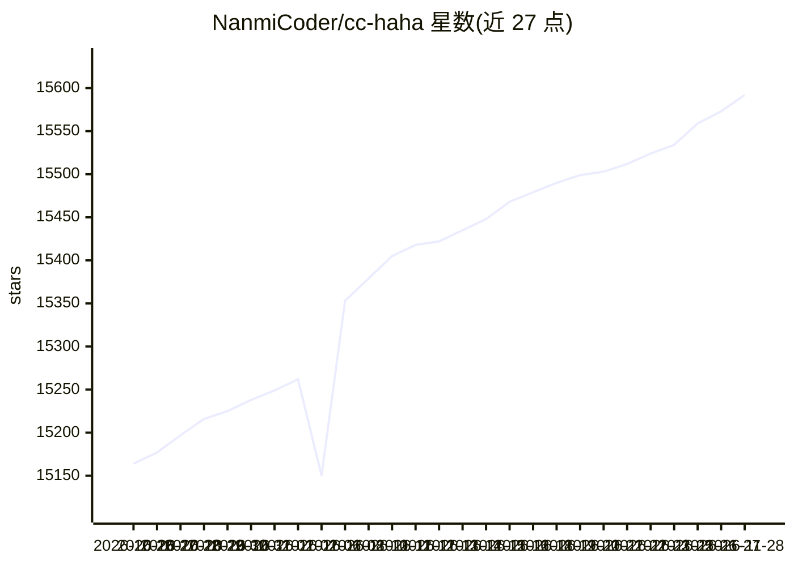

# NanmiCoder/cc-haha

⭐ 15,592 · TypeScript · NOASSERTION · 推送 2026-11-27 · [GitHub](https://github.com/NanmiCoder/cc-haha) · [官网](https://cchaha.ai) · 个人维护 · 中文 README

**Claude Code / AI Agent 的跨平台桌面工作台，支持远程审批**

基于 Electron 的桌面端 Claude Code 工作台，覆盖多会话与全局搜索、分支/Worktree 启动、逐文件 Diff 审阅、内置浏览器预览、五档权限审批、MCP 与 SubAgent 可视化管理、Agent Teams 多 Agent 协作、动态 Workflow 编排、Computer Use、技能市场与桌面宠物。模型自选：官方账号登录、第三方 API 预设及 LM Studio / Ollama 本地模型。提供 Android/iOS App 与 H5、IM（Telegram/飞书/微信/钉钉等）远程接入。macOS/Windows/Linux 安装包随 Releases 发布；许可为 Community Source License，非 OSI 认证开源。

## 筛选速览

| 维度 | 判定 | 备注 |
|---|---|---|
| AI 角色 | `ai-ecosystem` | LLM/agent 周边工具 |
| 许可风险 | `none` | NOASSERTION |
| 部署形态 | `None` |  |
| 模型依赖 | local-ok | 支持本地模型 |
| 硬件要求 | — | 无带数字的原话,不猜 |
| 安装摩擦 | `low` | 无编译、无系统依赖或容器化 |
| 成熟度 | — | 结构信号不足 |

## 动量与使用信号

- 维护:`active` — 距上次 push 1.0 天,年发版 55,38 位贡献者
- 涨星:近 1 天 **+22**(自 20261016 起算)
- 平台:WINDOWS / MACOS / LINUX · 协议:MCP / OLLAMA

## 能力要点

- 多会话工作台与 Worktree 启动、逐文件 Diff 审阅
- Agent Teams 多 Agent 协作与动态 Workflow 编排
- 多模型接入：官方账号登录、第三方 API 预设、LM Studio/Ollama 本地模型
- 手机 App、H5 与多 IM 渠道远程审批和派任务

## 适用场景

- 在桌面端集中管理多个 Claude Code 会话与代码改动
- 离开电脑时用手机审批工具调用和派新任务
- 图形化管理 MCP Server 与 SubAgent
- 用多个 Agent 组队并行推进开发任务

## 场景标签

`编码 Agent` `多智能体` `GUI 自动化` · 领域:Agent 开发

## 证据(README 行号)

> L16: cc-haha 是一个**桌面端 Claude Code 工作台**：多会话与全局搜索、分支 / Worktree 启动、Diff 审阅、内置浏览器预览、图形化权限审批、模型自选（Claude / ChatGPT / Grok /
> L128: - **模型自选**：Claude / ChatGPT / Grok 官方账号可直接登录；DeepSeek、Kimi、智谱 GLM 等第三方 API 有现成预设；LM Studio、Ollama 的本地模型也接得上。

## 星数曲线

2026-10-26 15,164 → 2026-11-28 15,592（+428）

---
*卡片 v1 · prompt 1.4 · 生成 2026-11-28 · 置信度 high · 依据 README sha `9c0bb9a89e64` · [字段定义](../../DATASET.md)*
