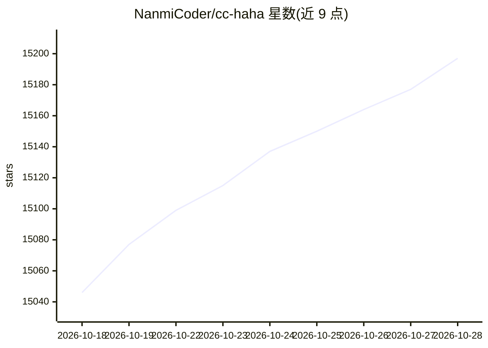

# NanmiCoder/cc-haha

⭐ 15,197 · TypeScript · NOASSERTION · 推送 2026-10-27 · [GitHub](https://github.com/NanmiCoder/cc-haha) · [官网](https://cchaha.ai) · 个人维护 · 中文 README

**给 Claude Code 用户的跨平台桌面工作台：多 Agent 协作与可视化管理**

基于 Electron 的桌面应用，将 Claude Code CLI 包装为图形化工作台：多会话管理、分支/Worktree 启动、Diff 审阅、内置浏览器预览、MCP 与 SubAgent 可视化管理、Agent Teams 协作、动态 Workflow 编排、Computer Use、技能市场、桌面宠物，以及 H5 与 IM 远程接入。模型侧支持官方账号登录、第三方 API 预设与本地模型端点。需在设置中配置模型提供商与 API Key；许可证为源码可用许可，非 OSI 认证，商业使用须书面授权。

## 筛选速览

| 维度 | 判定 | 备注 |
|---|---|---|
| AI 角色 | `ai-native` | 本体是模型或模型工具 |
| 许可风险 | `dual` | NOASSERTION |
| 部署形态 | `None` |  |
| 模型依赖 | local-ok | 支持本地模型 |
| 硬件要求 | — | 无带数字的原话,不猜 |
| 安装摩擦 | `low` | 无编译、无系统依赖或容器化 |
| 成熟度 | — | 结构信号不足 |

## 动量与使用信号

- 维护:`active` — 距上次 push 1.0 天,年发版 55,38 位贡献者
- 涨星:近 1 天 **+22**(自 20261016 起算)
- 平台:WINDOWS / MACOS / LINUX · 协议:MCP / OLLAMA

## 能力要点

- 多会话工作台：Worktree 启动、Diff 审阅、Cmd+K 全局搜索
- Agent Teams 多 Agent 协作与动态 Workflow 编排
- Computer Use 跨应用操作，macOS 上不占用真实鼠标键盘
- MCP 图形化管理与技能市场（ClawHub / SkillHub）

## 适用场景

- 想在图形界面里管理多个 Claude Code 会话和代码改动
- 通过手机 H5 或微信/飞书远程审批与对话
- 搭建多 Agent 协作团队执行编排任务
- 接入本地模型端点运行 Coding Agent

## 场景标签

`编码 Agent` `多智能体` · 领域:Agent 开发

## 证据(README 行号)

> L16: cc-haha 是一个**桌面端 Claude Code 工作台**：多会话与全局搜索、分支 / Worktree 启动、Diff 审阅、内置浏览器预览、图形化权限审批、模型自选（Claude / ChatGPT / Grok /
> L109: - **模型自选**：Claude / ChatGPT / Grok 官方账号可直接登录；DeepSeek、Kimi、智谱 GLM 等第三方 API 有现成预设；LM Studio、Ollama 的本地模型也接得上。
> L162: 当前采用 cc-haha Community Source License 1.0。允许个人非商业使用及企业内部自用；接单、对外商业盈利、收费修改或二次开发、商业分发及付费服务须事先取得书面商业授权；二次分发须显著保留来源署名。

## 星数曲线

2026-10-18 15,046 → 2026-10-28 15,197（+151）

---
*卡片 v1 · prompt 1.4 · 生成 2026-10-18 · 置信度 high · 依据 README sha `0fbd6f34c578` · [字段定义](../../DATASET.md)*
