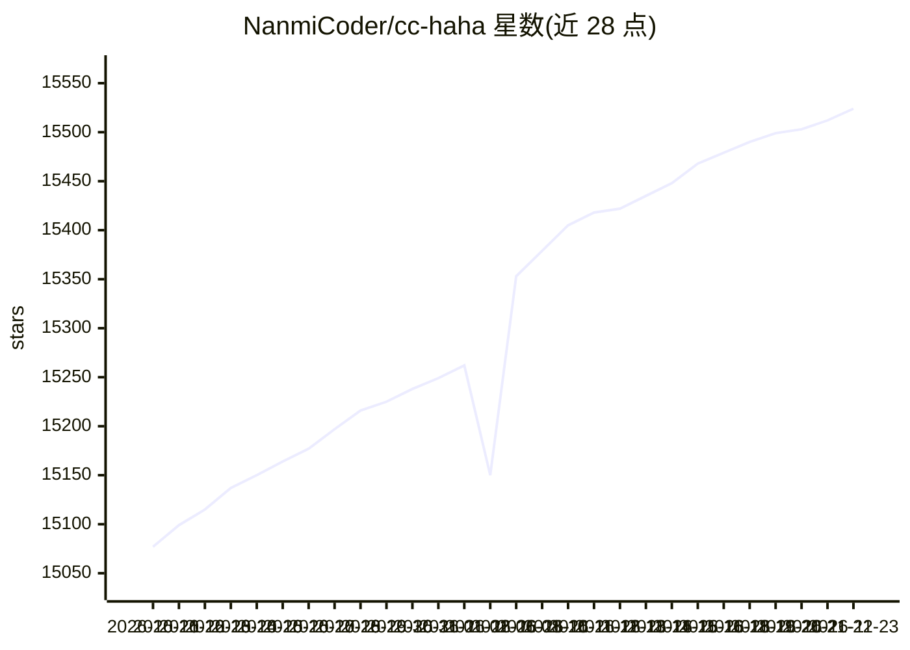

# NanmiCoder/cc-haha

⭐ 15,524 · TypeScript · NOASSERTION · 推送 2026-11-22 · [GitHub](https://github.com/NanmiCoder/cc-haha) · [官网](https://cchaha.ai) · 个人维护 · 中文 README

**为 Claude Code 用户提供多 Agent 协作与远程访问的桌面工作台**

基于 Electron 的桌面端应用，把 Claude Code / AI Agent 的工作流集中在本地 App 中：多会话管理与全局搜索、按分支或 Git Worktree 启动会话、Diff 逐文件审阅与撤销、MCP 与 SubAgent 图形化管理、Agent Teams 多 Agent 协作、动态 Workflow 编排、模型请求追踪、Computer Use 桌面控制、技能市场与定时任务。支持手机 App、H5 与 IM（微信/飞书/钉钉等）远程审批和派任务。需在设置中自行配置模型提供商与 API Key。当前许可为 Community Source License，非 OSI 认证开源许可。

## 筛选速览

| 维度 | 判定 | 备注 |
|---|---|---|
| AI 角色 | `ai-ecosystem` | LLM/agent 周边工具 |
| 许可风险 | `none` | NOASSERTION |
| 部署形态 | `None` |  |
| 模型依赖 | local-ok | 支持本地模型 |
| 硬件要求 | — | 无带数字的原话,不猜 |
| 安装摩擦 | `low` | 无编译、无系统依赖或容器化 |
| 成熟度 | — | 结构信号不足 |

## 动量与使用信号

- 维护:`active` — 距上次 push 1.0 天,年发版 55,38 位贡献者
- 涨星:近 1 天 **+22**(自 20261016 起算)
- 平台:WINDOWS / MACOS / LINUX · 协议:MCP / OLLAMA

## 能力要点

- Agent Teams 多 Agent 协作工作台与动态 Workflow 编排
- 模型自选：官方账号登录、第三方 API 预设、LM Studio/Ollama 本地模型
- 手机 App、H5 与多平台 IM 远程审批与派任务
- MCP 图形化管理（STDIO/HTTP/SSE，三种作用域）

## 适用场景

- 在图形界面集中管理多个 Claude Code 会话与改动审阅
- 离开工位时用手机或 IM 审批工具调用、派新任务
- 组织多 Agent 团队并行拆解和推进开发任务

## 场景标签

`多智能体` `编码 Agent` `GUI 自动化` `工作流自动化` · 领域:Agent 开发

## 证据(README 行号)

> L16: cc-haha 是一个**桌面端 Claude Code 工作台**：多会话与全局搜索、分支 / Worktree 启动、Diff 审阅、内置浏览器预览、图形化权限审批、模型自选（Claude / ChatGPT / Grok /
> L125: - **模型自选**：Claude / ChatGPT / Grok 官方账号可直接登录；DeepSeek、Kimi、智谱 GLM 等第三方 API 有现成预设；LM Studio、Ollama 的本地模型也接得上。
> L178: 当前采用 cc-haha Community Source License 1.0。允许个人非商业使用及企业内部自用；接单、对外商业盈利、收费修改或二次开发、商业分发及付费服务须事先取得书面商业授权；二次分发须显著保留来源署名。

## 星数曲线

2026-10-21 15,077 → 2026-11-23 15,524（+447）

---
*卡片 v1 · prompt 1.4 · 生成 2026-11-23 · 置信度 high · 依据 README sha `8ca1cf378e44` · [字段定义](../../DATASET.md)*
