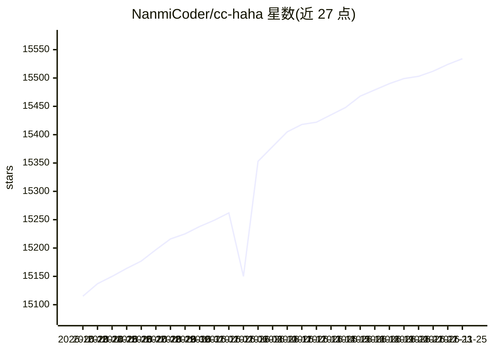

# NanmiCoder/cc-haha

⭐ 15,534 · TypeScript · NOASSERTION · 推送 2026-11-23 · [GitHub](https://github.com/NanmiCoder/cc-haha) · [官网](https://cchaha.ai) · 个人维护 · 中文 README

**Claude Code / AI Agent 的跨平台桌面工作台，含远程审批**

基于 Electron 的桌面端应用，为 Claude Code 与 AI Agent 会话提供图形化工作环境：多会话与全局搜索、分支/Worktree 启动、Diff 审阅、五档权限审批、MCP 与 SubAgent 可视化管理、Agent Teams 协作、Workflow 编排、Computer Use、技能市场与桌面宠物。模型可通过 Claude/ChatGPT/Grok 账号登录、第三方 API 预设或 LM Studio/Ollama 本地端点接入。提供 macOS/Windows/Linux 安装包，配套 Android/iOS App 扫码远程审批与派任务，支持 Telegram/飞书/微信/钉钉等 IM 接入。

## 筛选速览

| 维度 | 判定 | 备注 |
|---|---|---|
| AI 角色 | `ai-ecosystem` | LLM/agent 周边工具 |
| 许可风险 | `none` | NOASSERTION |
| 部署形态 | `None` |  |
| 模型依赖 | local-ok | 支持本地模型 |
| 硬件要求 | — | 无带数字的原话,不猜 |
| 安装摩擦 | `low` | 无编译、无系统依赖或容器化 |
| 成熟度 | — | 结构信号不足 |

## 动量与使用信号

- 维护:`active` — 距上次 push 1.0 天,年发版 55,38 位贡献者
- 涨星:近 1 天 **+22**(自 20261016 起算)
- 平台:WINDOWS / MACOS / LINUX · 协议:MCP / OLLAMA

## 能力要点

- 多会话工作台：标签页、全局搜索、分支/Worktree 启动、逐文件 Diff 审阅
- Agent Teams 协作与动态 Workflow 编排，可视化 SubAgent 管理
- 模型自选：官方账号登录、第三方 API 预设、LM Studio/Ollama 本地模型
- 手机 App/H5 与多平台 IM 远程审批、派任务，任务在电脑端运行

## 适用场景

- 在图形界面里集中管理多个 Claude Code 会话与权限审批
- 用多 Agent 团队拆分并行推进开发任务
- 离开工位时通过手机或 IM 审批工具调用、派新任务
- 接入本地模型端点运行 Agent 会话

## 场景标签

`编码 Agent` `多智能体` `GUI 自动化` · 领域:Agent 开发

## 证据(README 行号)

> L16: cc-haha 是一个**桌面端 Claude Code 工作台**：多会话与全局搜索、分支 / Worktree 启动、Diff 审阅、内置浏览器预览、图形化权限审批、模型自选（Claude / ChatGPT / Grok /
> L125: - **模型自选**：Claude / ChatGPT / Grok 官方账号可直接登录；DeepSeek、Kimi、智谱 GLM 等第三方 API 有现成预设；LM Studio、Ollama 的本地模型也接得上。

## 星数曲线

2026-10-23 15,115 → 2026-11-25 15,534（+419）

---
*卡片 v1 · prompt 1.4 · 生成 2026-11-24 · 置信度 high · 依据 README sha `16ee887f8865` · [字段定义](../../DATASET.md)*
