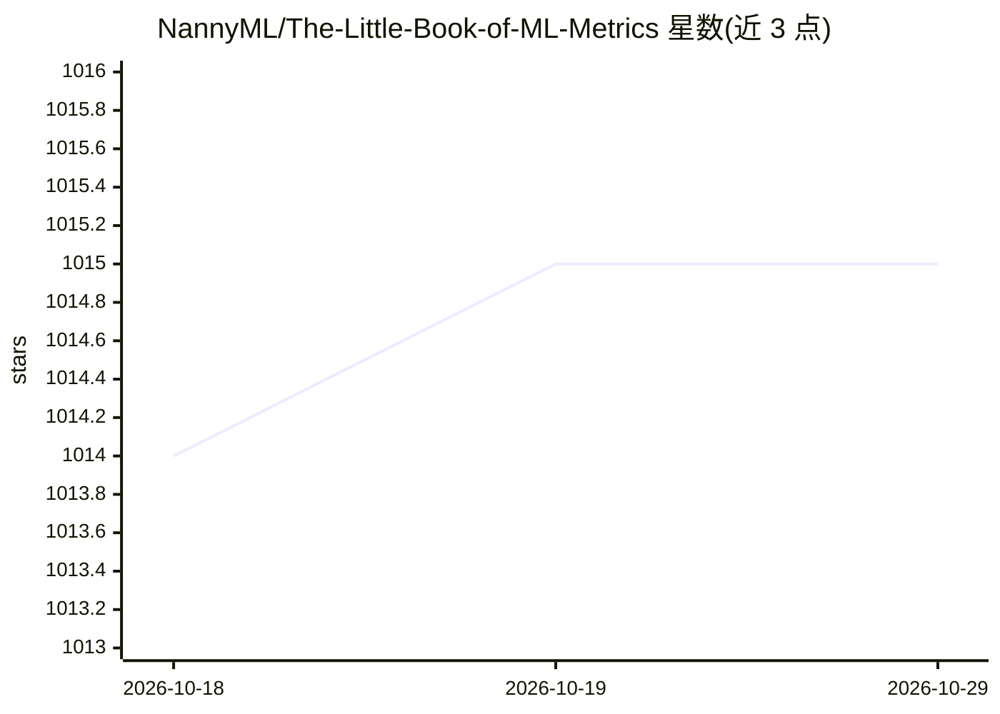

# NannyML/The-Little-Book-of-ML-Metrics

⭐ 1,015 · Jupyter Notebook · 推送 2026-10-17 · [GitHub](https://github.com/NannyML/The-Little-Book-of-ML-Metrics) · [官网](https://www.nannyml.com/metrics) · 组织维护

**数据科学家桌面速查手册：机器学习指标解析**

NannyML 支持的开源书籍项目，系统讲解机器学习各类指标，覆盖回归、分类、聚类、排序、计算机视觉、NLP、GenAI、概率、偏差与公平性及数据可观测性共 10 类上下文，定位为数据科学从业者与学习者的快速参考手册。数字版免费开放获取，另提供付费印刷版，销售收入支持书籍维护，贡献者与审阅者通过联盟链接获得分成。作者为 NannyML 的开发者布道师与联合创始人/CTO。

## 筛选速览

| 维度 | 判定 | 备注 |
|---|---|---|
| AI 角色 | `ai-knowledge` | 知识聚合/清单类 |
| 许可风险 | `none` | — |
| 部署形态 | `None` |  |
| 模型依赖 | — | README 未给出锁定关系 |
| 硬件要求 | — | 无带数字的原话,不猜 |
| 安装摩擦 | `low` | 无编译、无系统依赖或容器化 |
| 成熟度 | — | 结构信号不足 |

## 能力要点

- 覆盖 10 类机器学习指标主题（回归/分类/聚类/排序/CV/NLP/GenAI 等）
- 数字版开源免费，提供预发布版在线预览
- 接受社区贡献，贡献者与审阅者获联盟链接分成并署名

## 适用场景

- 数据科学家快速查阅各类 ML 指标的定义与用法
- 补充传统课程中缺失的模型评估指标知识
- 系统性了解 GenAI、偏差与公平性等新方向指标

## 场景标签

`教程课程` · 领域:学习与行业

## 证据(README 行号)

> L3: Welcome to the open source repo of The Little Book of ML Metrics. The idea of the book is to be this little handbook
> L18: The book covers a broad range of metrics from different contexts:
> L20: - **Regression**

## 星数曲线

2026-10-18 1,014 → 2026-10-29 1,015（+1）

---
*卡片 v1 · prompt 1.4 · 生成 2026-10-21 · 置信度 high · 依据 README sha `678c69f1a537` · [字段定义](../../DATASET.md)*
