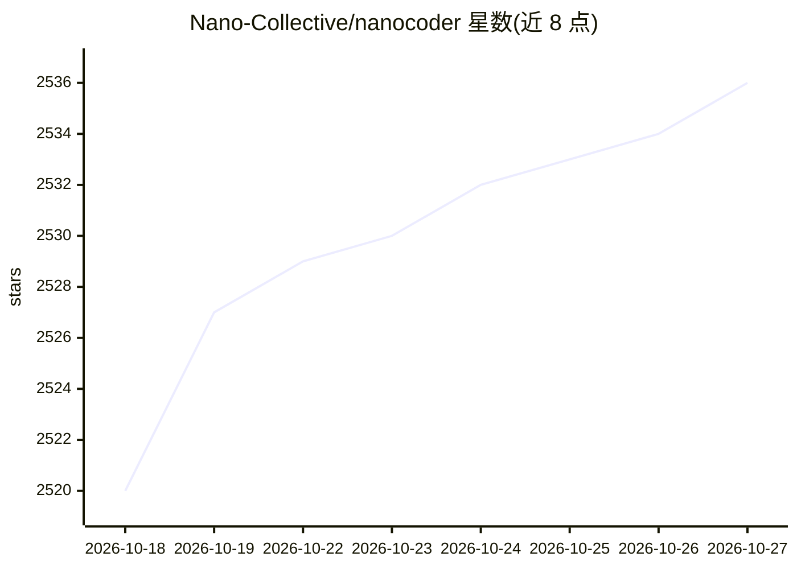

# Nano-Collective/nanocoder

⭐ 2,536 · TypeScript · NOASSERTION · 推送 2026-10-26 · [GitHub](https://github.com/Nano-Collective/nanocoder) · [官网](https://docs.nanocollective.org/nanocoder) · 组织维护

**社区集体开发的开源终端编码 agent，自选模型本地优先**

由 Nano Collective 社区集体（非公司）维护的终端编码代理：以 agentic coding 方式执行代码分析等任务，模型可自选——通过 Ollama 接本地模型，或任意 OpenAI 兼容 API（OpenRouter、Requesty、Anthropic、Google 等）。提供 skills、生命周期钩子、按项目守护进程、检查点与任务管理等能力；review 命令为 diff-only v1 且要求 TTY 交互终端，worktree 命令依赖 Git 与已认证的 gh CLI。

## 筛选速览

| 维度 | 判定 | 备注 |
|---|---|---|
| AI 角色 | `ai-ecosystem` | LLM/agent 周边工具 |
| 许可风险 | `none` | NOASSERTION |
| 部署形态 | `library` | 以包/库形式分发 |
| 模型依赖 | local-ok | 支持本地模型 |
| 硬件要求 | — | 无带数字的原话,不猜 |
| 安装摩擦 | `low` | 无编译、无系统依赖或容器化 |
| 成熟度 | `idea` | |

## 能力要点

- 多提供商接入：Ollama 本地模型或任意 OpenAI 兼容 API
- Skills（命令、子代理、工具、事件触发）与生命周期钩子
- 按项目守护进程、检查点、任务管理与两种终端渲染模式
- 无付费层级、无遥测的社区集体开发模式

## 适用场景

- 在终端用自选模型进行 agentic 编码与代码分析
- 本地 Ollama 模型下保留代码与数据在自有机器上
- 跨 PR 检出 worktree 在隔离目录中开展编码工作

## 场景标签

`编码 Agent` · 领域:编码与开发

## 证据(README 行号)

> L8: Built by the Nano Collective, a community collective building AI tooling not for profit, but for the community. Nano
> L6: An open coding agent for your terminal, built by a community collective rather than a company. Bring your own model,

## 星数曲线

2026-10-18 2,520 → 2026-10-27 2,536（+16）

---
*卡片 v1 · prompt 1.4 · 生成 2026-10-21 · 置信度 high · 依据 README sha `87f3bac83c5c` · [字段定义](../../DATASET.md)*
