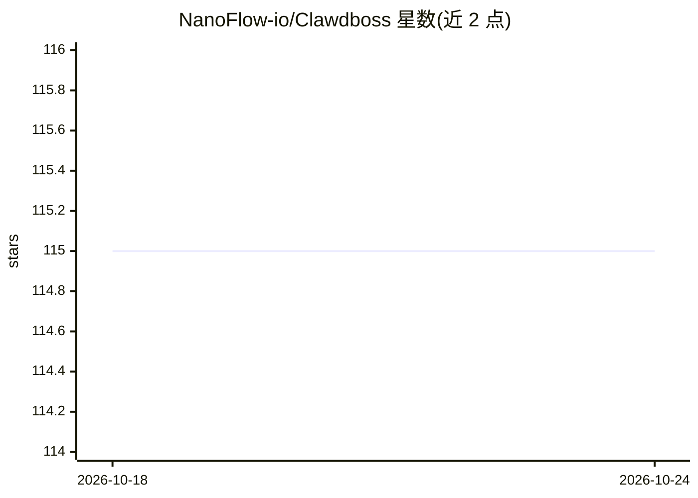

# NanoFlow-io/Clawdboss

⭐ 115 · Shell · NOASSERTION · 推送 2026-03-21 · [GitHub](https://github.com/NanoFlow-io/Clawdboss) · 组织维护

**一键脚本部署预加固的 OpenClaw 多 Agent AI 助手**

面向在 Ubuntu VPS 上自建 AI 助手的用户：通过一条脚本和交互式向导完成 OpenClaw 多 Agent（主 Agent + Comms/Research/Security 专家）部署，内置提示注入防御、防循环规则、凭证隔离与定时安全审计。支持 Discord、Telegram 及 ClawSuite Console 三种界面，采用 WAL 协议与三层记忆（SQLite+FTS5 / LanceDB）实现上下文持久化。LLM 需自备 GitHub Copilot（经 copilot-api 代理）、OpenAI 或 Anthropic API key。需 Linux 环境，2GB+ 内存推荐。

## 筛选速览

| 维度 | 判定 | 备注 |
|---|---|---|
| AI 角色 | `ai-ecosystem` | LLM/agent 周边工具 |
| 许可风险 | `none` | NOASSERTION |
| 部署形态 | `library` | 以包/库形式分发 |
| 模型依赖 | — | README 未给出锁定关系 |
| 硬件要求 | — | 无带数字的原话,不猜 |
| 安装摩擦 | `medium` | 含编译或系统依赖之一 |
| 成熟度 | — | 结构信号不足 |

## 能力要点

- 一条脚本完成 OpenClaw 依赖安装与多 Agent 配置
- 提示注入防御、凭证隔离与定时安全审计
- WAL 协议 + 三层记忆实现上下文压缩后恢复
- Discord/Telegram/Web Console 多界面接入

## 适用场景

- 在 VPS 上快速部署安全加固的多 Agent AI 助手
- 通过 Discord 或 Telegram 与自托管 Agent 对话
- 让 Agent 在上下文重置后仍保留纠正与决策记录

## 场景标签

`多智能体` `AI 助手` · 领域:Agent 开发

## 证据(README 行号)

> L3: **Pre-hardened, multi-agent OpenClaw setup by NanoFlow.**
> L45: That's it. The wizard auto-installs all dependencies (Node.js 22, Python, git, build-essential, OpenClaw) and walks
> L171: openclaw gateway start

## 星数曲线

2026-10-18 115 → 2026-10-24 115（+0）

---
*卡片 v1 · prompt 1.4 · 生成 2026-10-23 · 置信度 mid · 依据 README sha `870b07d50fb0` · [字段定义](../../DATASET.md)*
