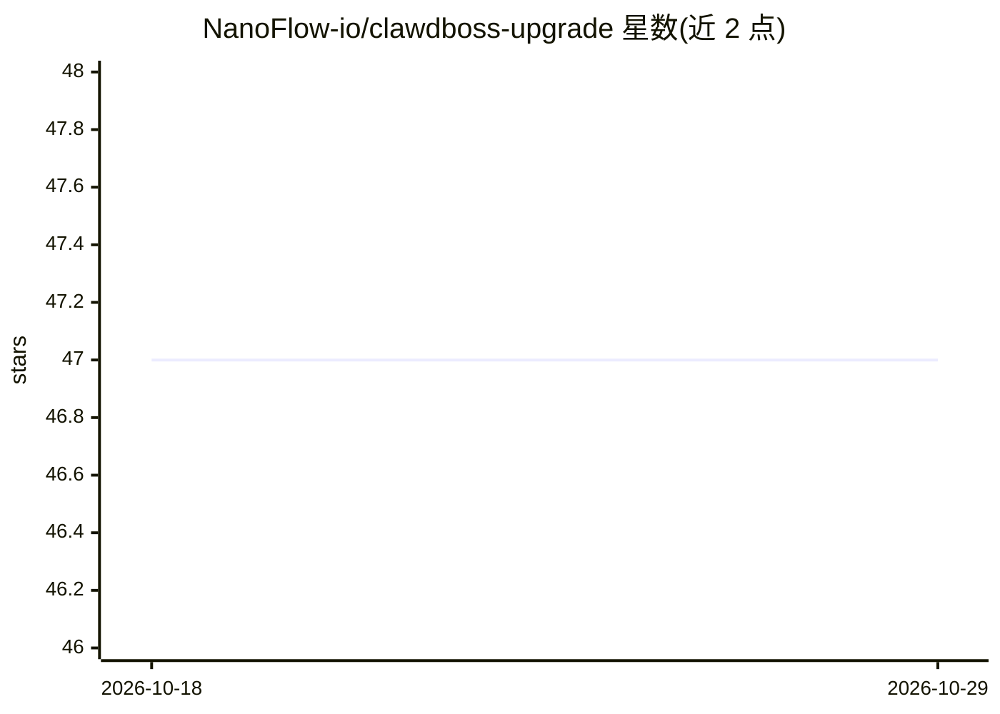

# NanoFlow-io/clawdboss-upgrade

⭐ 47 · Shell · 推送 2026-03-11 · [GitHub](https://github.com/NanoFlow-io/clawdboss-upgrade) · [官网](https://github.com/NanoFlow-io/clawdboss) · 组织维护

**已有 OpenClaw 安装的非破坏性升级脚本**

面向已有可运行 OpenClaw 安装的用户，提供 bash 脚本将 Clawdboss 生态的改进合并进现有安装：按标题做分段感知的 markdown 合并、补齐 openclaw.json 缺失配置键、迁移明文 API 密钥到 .env、安装缺失技能与 memory-hybrid 扩展（SQLite + LanceDB 两级记忆）。任何修改前对整个 ~/.openclaw 做带时间戳的备份，支持 dry-run 预览与幂等重复执行。依赖 Python 3、Node.js/npm 与 git，需已有 openclaw.json。作为 Clawdboss 的配套工具，不用于全新安装。

## 筛选速览

| 维度 | 判定 | 备注 |
|---|---|---|
| AI 角色 | `ai-ecosystem` | LLM/agent 周边工具 |
| 许可风险 | `none` | — |
| 部署形态 | `library` | 以包/库形式分发 |
| 模型依赖 | — | README 未给出锁定关系 |
| 硬件要求 | — | 无带数字的原话,不猜 |
| 安装摩擦 | `low` | 无编译、无系统依赖或容器化 |
| 成熟度 | — | 结构信号不足 |

## 能力要点

- 分段感知的 markdown 合并，不覆盖既有内容
- 修改前自动时间戳备份，可整目录回滚
- dry-run 预览与幂等设计
- 检测明文 API 密钥并迁移到 .env

## 适用场景

- 把已定制过的 OpenClaw 安装升级到 Clawdboss 配置而不丢改动
- 预览升级将产生的变更
- 将配置中的明文密钥迁移到环境变量

## 场景标签

 · 领域:AI agent 基础设施/运维工具

## 证据(README 行号)

> L3: **Non-destructive upgrade tool for existing OpenClaw installations.**
> L5: Already have a working OpenClaw setup? This script merges Clawdboss improvements into your existing install — withou

## 星数曲线

2026-10-18 47 → 2026-10-29 47（+0）

---
*卡片 v1 · prompt 1.4 · 生成 2026-10-25 · 置信度 mid · 依据 README sha `28d9a3dd5f66` · [字段定义](../../DATASET.md)*
