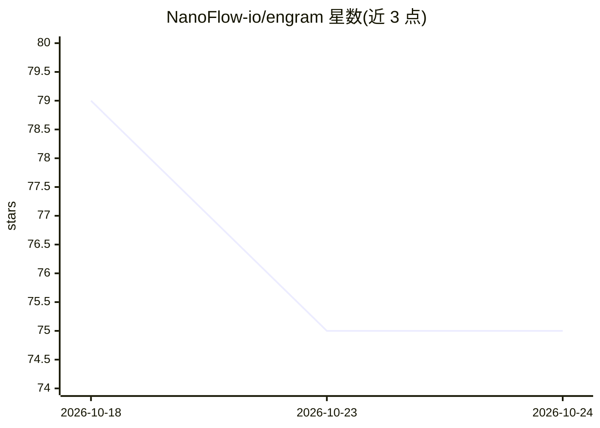

# NanoFlow-io/engram

⭐ 75 · TypeScript · MIT · 推送 2026-06-08 · [GitHub](https://github.com/NanoFlow-io/engram) · 组织维护

**OpenClaw agent 的混合长期记忆插件：SQLite+FTS5 与 LanceDB 双存储**

面向 OpenClaw agent 框架的记忆插件（Plugin type: memory），为 agent 提供跨会话的长期记忆：结构化键值事实存入 SQLite+FTS5，语义向量检索由 LanceDB 承担，每条记忆双写、召回时按相关性合并结果。支持 5 类记忆分类、5 级衰减等级（含置信度衰减）、可配置的自动捕获/自动召回钩子，嵌入依赖 OpenAI text-embedding-3 系列模型。本地优先存储，提供一键安装脚本、`engram` CLI 子命令与卸载脚本。

## 筛选速览

| 维度 | 判定 | 备注 |
|---|---|---|
| AI 角色 | `ai-ecosystem` | LLM/agent 周边工具 |
| 许可风险 | `permissive` | MIT |
| 部署形态 | `None` |  |
| 模型依赖 | — | README 未给出锁定关系 |
| 硬件要求 | — | 无带数字的原话,不猜 |
| 安装摩擦 | `low` | 无编译、无系统依赖或容器化 |
| 成熟度 | — | 结构信号不足 |

## 能力要点

- SQLite+FTS5 结构化事实与 LanceDB 语义检索的混合召回，双写合并
- 记忆分类（preference/fact/decision/entity/other）与衰减等级（permanent 到 checkpoint）
- 可配置的自动捕获与自动召回钩子
- 本地优先存储，数据保存在 ~/.openclaw/ 下

## 适用场景

- 让 OpenClaw agent 在会话之间记住用户偏好与事实
- 为 agent 注入相关历史记忆作为上下文
- 通过 CLI 查看记忆统计、清理过期记忆与手动打检查点

## 场景标签

`Agent 记忆` · 领域:Agent 开发

## 证据(README 行号)

> L11: OpenClaw
> L16: **Engram** is the **hybrid long-term memory plugin for OpenClaw agents**. It gives your agent a brain that doesn't 
> L22: - 🧠 **Hybrid recall** — structured key/value facts + semantic vector search, queried together

## 星数曲线

2026-10-18 79 → 2026-10-24 75（-4）

---
*卡片 v1 · prompt 1.4 · 生成 2026-10-24 · 置信度 high · 依据 README sha `2d9ae1874b43` · [字段定义](../../DATASET.md)*
