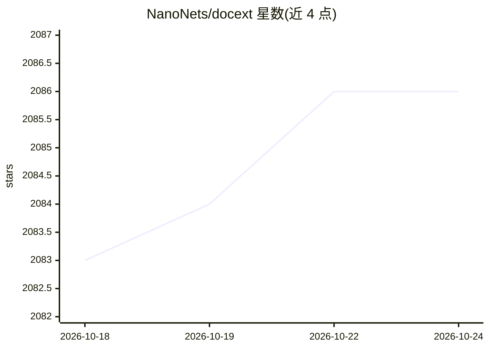

# NanoNets/docext

⭐ 2,086 · Python · Apache-2.0 · 推送 2026-03-17 · [GitHub](https://github.com/NanoNets/docext) · [官网](https://nanonets.com/document-parsing-and-extraction) · 组织维护

**本地部署的 OCR-free 文档信息抽取与 Markdown 转换工具包**

Nanonets 开发的本地部署文档智能工具包，基于视觉语言模型（VLM）提供三项能力：PDF/图片转 Markdown（含 LaTeX 公式、签名、水印、表格识别与语义标注）；OCR-free 的结构化信息抽取（发票、护照等预置模板，自定义字段，置信度评分，多页支持，REST API）；以及智能文档处理排行榜，覆盖 KIE、VQA、OCR、文档分类等七类任务的模型评测。同库发布 3B 参数的 Nanonets-OCR-s 模型，支持 Linux/macOS 自有基础设施运行。

## 筛选速览

| 维度 | 判定 | 备注 |
|---|---|---|
| AI 角色 | `ai-native` | 本体是模型或模型工具 |
| 许可风险 | `permissive` | Apache-2.0 |
| 部署形态 | `library` | 以包/库形式分发 |
| 模型依赖 | — | README 未给出锁定关系 |
| 硬件要求 | — | 无带数字的原话,不猜 |
| 安装摩擦 | `low` | 无编译、无系统依赖或容器化 |
| 成熟度 | — | 结构信号不足 |

## 能力要点

- PDF/图片转 Markdown：LaTeX 公式、签名/水印/页码标注、表格转 HTML、复选框转 Unicode
- OCR-free 结构化抽取，预置发票/护照模板，输出置信度评分
- 覆盖七类文档智能任务的评测排行榜（idp-leaderboard.org）
- 本地部署，提供 REST API 与多页文档支持

## 适用场景

- 把发票、护照等文档批量转为结构化字段数据
- 将 PDF 或扫描件转换为带语义标注的 Markdown
- 在自有基础设施上部署文档抽取而不外发数据
- 对比各视觉语言模型在文档任务上的表现

## 场景标签

`OCR` `文档解析` `模型评测` · 领域:评测与运维

## 证据(README 行号)

> L28: docext is a comprehensive on-premises document intelligence toolkit powered by vision-language models (VLMs). It pr
> L32: **🔍 Document Information Extraction**: OCR-free extraction of structured information (fields, tables, etc.) from do

## 星数曲线

2026-10-18 2,083 → 2026-10-24 2,086（+3）

---
*卡片 v1 · prompt 1.4 · 生成 2026-10-21 · 置信度 high · 依据 README sha `fa505b10ee80` · [字段定义](../../DATASET.md)*
