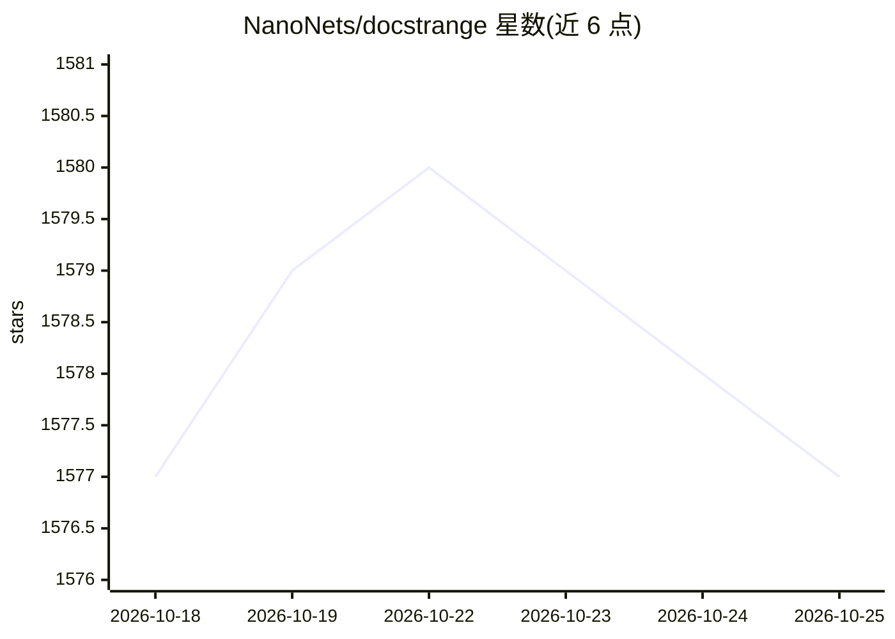

# NanoNets/docstrange

⭐ 1,578 · Python · MIT · 推送 2025-10-31 · [GitHub](https://github.com/NanoNets/docstrange) · [官网](https://docstrange.nanonets.com/) · 组织维护

**文档解析库：将 PDF/图片/Office/URL 转为 Markdown、JSON、CSV 等结构化数据**

由 Nanonets 开发的 Python 库（要求 Python>=3.8），将 PDF、DOCX、PPTX、XLSX、图片和 URL 转换为 LLM 优化的 Markdown 及结构化 JSON/CSV/HTML，核心为 7B 参数模型驱动的 OCR 与版面检测流水线。支持指定字段或自定义 JSON schema 做结构化提取，提供免费云 API（每月 1 万文档）或 GPU/CPU 本地模式，内置本地拖放 Web UI，并可通过 MCP server 接入 Claude Desktop。本地 GPU 模式需要 CUDA。

## 筛选速览

| 维度 | 判定 | 备注 |
|---|---|---|
| AI 角色 | `ai-native` | 本体是模型或模型工具 |
| 许可风险 | `permissive` | MIT |
| 部署形态 | `library` | 以包/库形式分发 |
| 模型依赖 | — | README 未给出锁定关系 |
| 硬件要求 | — | 无带数字的原话,不猜 |
| 安装摩擦 | `medium` | 含编译或系统依赖之一 |
| 成熟度 | — | 结构信号不足 |

## 能力要点

- 7B 模型驱动的 OCR + 版面检测 + 表格识别流水线，支持扫描件与手机照片
- 按指定字段或自定义 JSON schema 做结构化数据提取
- 云 API 或 100% 本地 GPU/CPU 两种处理模式
- 内置本地拖放 Web UI，并经 MCP server 接入 Claude Desktop

## 适用场景

- 把复杂 PDF/DOCX 转成干净 Markdown 供 RAG 管线使用
- 从发票等文档中按字段或 JSON schema 抽取结构化数据
- 在本地 GPU 上离线处理隐私敏感文档

## 场景标签

`文档解析` `OCR` · 领域:知识与检索

## 证据(README 行号)

> L22: - Powered by an upgraded 7B model for higher accuracy and deeper document understanding.
> L23: - Extracts text from images and scanned documents with advanced OCR.
> L53: The library offers both a powerful cloud API and a 100% private, offline mode that runs locally on your GPU. Develo

## 星数曲线

2026-10-18 1,577 → 2026-10-25 1,577（+0）

---
*卡片 v1 · prompt 1.4 · 生成 2026-10-21 · 置信度 high · 依据 README sha `9cbeb01ebab8` · [字段定义](../../DATASET.md)*
