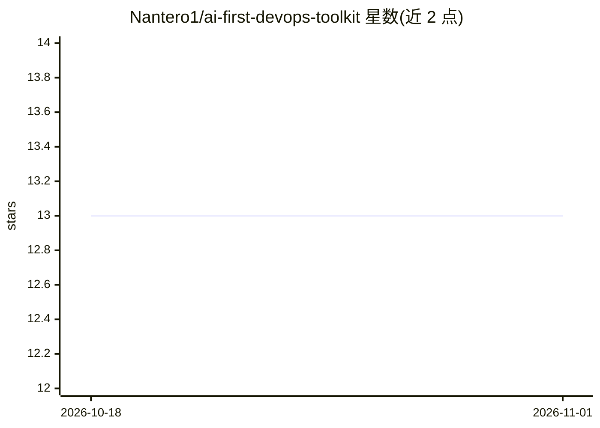

# Nantero1/ai-first-devops-toolkit

⭐ 13 · Python · MIT · 推送 2026-07-16 · [GitHub](https://github.com/Nantero1/ai-first-devops-toolkit) · [官网](https://technologyworkroom.blogspot.com/2025/06/building-ai-first-devops.html) · 个人维护

**CI/CD 中运行 LLM 任务并强制 schema 校验的 CLI 工具**

名为 llm-ci-runner 的 Python CLI 与库：读取 JSON/YAML 输入或 Handlebars/Jinja2/Semantic Kernel YAML 模板，调用 Azure OpenAI（优先，支持 RBAC 与 API Key 认证）或 OpenAI（回退），输出经 JSON Schema 强制校验的 JSON/YAML 结果，供流水线下游系统使用。提供指数退避重试、文件 I/O、Rich 日志与 LLM-as-Judge 验收测试模式。面向要在 DevOps 流水线中接入 LLM 做结构化抽取与质量门禁的工程团队。

## 筛选速览

| 维度 | 判定 | 备注 |
|---|---|---|
| AI 角色 | `ai-ecosystem` | LLM/agent 周边工具 |
| 许可风险 | `permissive` | MIT |
| 部署形态 | `library` | 以包/库形式分发 |
| 模型依赖 | locked-api |  |
| 硬件要求 | — | 无带数字的原话,不猜 |
| 安装摩擦 | `low` | 无编译、无系统依赖或容器化 |
| 成熟度 | — | 结构信号不足 |

## 能力要点

- 提供 --schema-file 时的 Token 级 schema 强制校验，输出符合 JSON Schema（含 enum/数值/数组约束）
- 支持 Handlebars/Jinja2/Microsoft Semantic Kernel YAML 模板生成动态 prompt
- Azure OpenAI 优先接入，支持 DefaultAzureCredential RBAC 认证，OpenAI API Key 回退
- 无状态 CLI：读 JSON/YAML 入、写 JSON/YAML 出、以退出码报告结果，适配 CI/CD

## 适用场景

- 在流水线中把 PR 描述、日志、文档等非结构化数据转为结构化 JSON
- 用 LLM 生成带 schema 保证的代码评审/安全分析结果做质量门禁
- 以模板复用方式在多场景下参数化运行 LLM 任务

## 场景标签

`提示工程` · 领域:Agent 开发

## 证据(README 行号)

> L69: - 🚀 **Zero-Friction CLI**: Single script, minimal configuration for pipeline integration and automation
> L71: - 📦 **CI-friendly CLI**: Stateless command that reads JSON/YAML, writes JSON/YAML, and exits with proper codes
> L94: pip install llm-ci-runner

## 星数曲线

2026-10-18 13 → 2026-11-01 13（+0）

---
*卡片 v1 · prompt 1.4 · 生成 2026-10-31 · 置信度 high · 依据 README sha `ea84d13e623b` · [字段定义](../../DATASET.md)*
