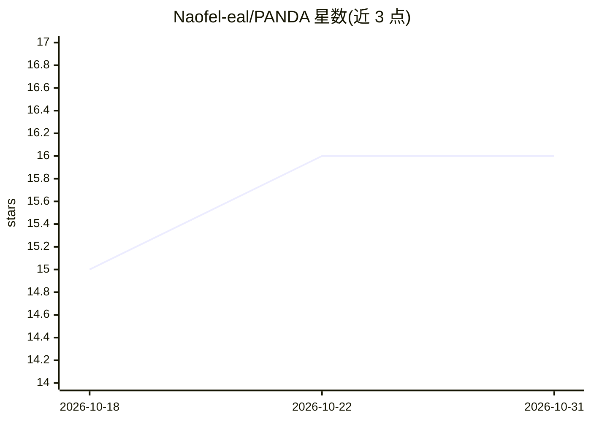

# Naofel-eal/PANDA

⭐ 16 · Java · NOASSERTION · 推送 2026-05-22 · [GitHub](https://github.com/Naofel-eal/PANDA) · 个人维护

**自治编码编排器：从 Jira 票据到 GitHub PR 的全流程自动化**

基于 Quarkus 的编排服务，轮询 Jira 票据并驱动 AI agent（OpenCode）完成信息收集、代码实现、技术验证与业务验证四个阶段，自动建分支、提交、推送并开启或复用 PR，跟进评审与验证反馈。无数据库与持久队列，工作流以 JSON 文件落盘，重启后可恢复。安全设计上 agent 容器不接触 Jira 凭据，Git 操作全部由编排器执行，分支限定 panda/ 前缀并有硬超时。Docker Compose 部署，许可证为 PolyForm Noncommercial（非商业）。

## 筛选速览

| 维度 | 判定 | 备注 |
|---|---|---|
| AI 角色 | `ai-native` | 本体是模型或模型工具 |
| 许可风险 | `none` | NOASSERTION |
| 部署形态 | `self-host` | docker 或自建部署 |
| 模型依赖 | locked-api |  |
| 硬件要求 | — | 无带数字的原话,不猜 |
| 安装摩擦 | `low` | 无编译、无系统依赖或容器化 |
| 成熟度 | — | 结构信号不足 |

## 能力要点

- 四阶段工作流（信息收集/实现/技术验证/业务验证）自动处理票据到 PR
- 凭据隔离：agent 仅获得模型推理凭据，Git 操作由编排器执行
- 工作流以 JSON 文件持久化，无数据库与持久队列
- 支持 Copilot/Anthropic/OpenAI/Gemini 模型凭据接入

## 适用场景

- 团队把 Jira 票据自动转化为代码实现与 PR
- 自动跟进 PR 评审评论与业务验证反馈
- 隔离凭据地运行带 shell 权限的编码 agent

## 场景标签

`编码 Agent` `工作流自动化` · 领域:效率与自动化

## 证据(README 行号)

> L12: PANDA is an autonomous coding orchestrator for Jira and GitHub. Drop a ticket in Jira, and an AI agent (OpenCode) p
> L20: 1. `INFORMATION_COLLECTION`
> L23:  The agent modifies the code, runs relevant validation commands, and signals that the local work is complete. The o

## 星数曲线

2026-10-18 15 → 2026-10-31 16（+1）

---
*卡片 v1 · prompt 1.4 · 生成 2026-10-30 · 置信度 high · 依据 README sha `4fc32856833a` · [字段定义](../../DATASET.md)*
