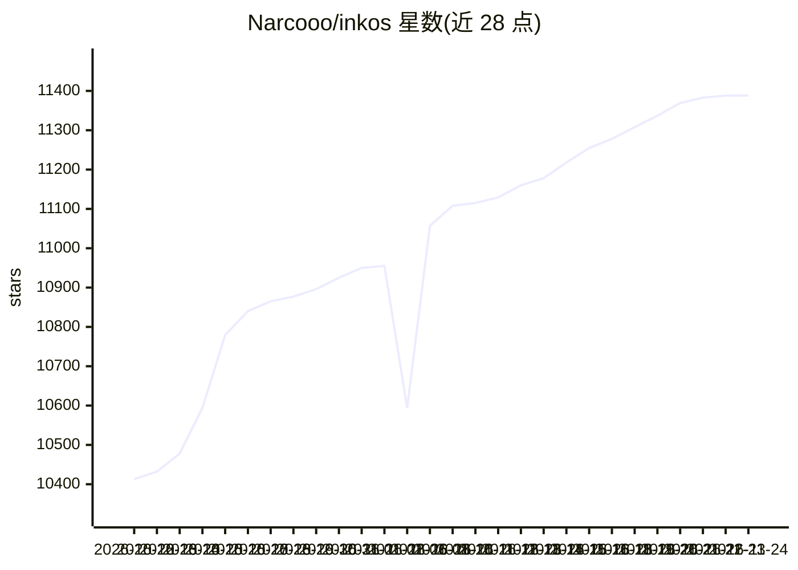

# Narcooo/inkos

⭐ 11,413 · TypeScript · AGPL-3.0 · 推送 2026-10-24 · [GitHub](https://github.com/Narcooo/inkos) · 组织维护 · 中文 README

**面向小说/剧本/互动影游创作的 AI Agent 工作台**

InkOS 是一个故事创作与多语言翻译的 AI Agent 系统，覆盖长篇连载、独立短篇、剧本剧作、同人创作、互动影游、开放世界与长文翻译。v2.0 收敛为基于 pi-agent 的统一生产 harness，模型负责理解与调用能力，InkOS 负责状态管理、原子落盘与产物真实性；内置 19 个专业 Skills（SKILL.md 格式），用 SQLite FTS5/BM25 做本地检索，提供 Studio（网页工作台）、TUI、CLI 三种交互形式，并通过 OpenClaw Skill 暴露给外部 Agent。需 Node.js 22.16+，npm 全局安装，使用需自行配置 LLM 服务与 API Key。

## 筛选速览

| 维度 | 判定 | 备注 |
|---|---|---|
| AI 角色 | `ai-native` | 本体是模型或模型工具 |
| 许可风险 | `viral` | AGPL-3.0 |
| 部署形态 | `library` | 以包/库形式分发 |
| 模型依赖 | local-ok | 支持本地模型 |
| 硬件要求 | — | 无带数字的原话,不猜 |
| 安装摩擦 | `low` | 无编译、无系统依赖或容器化 |
| 成熟度 | — | 结构信号不足 |

## 能力要点

- 支持 Studio/TUI/CLI/OpenClaw 四种交互入口，共用同一执行内核
- 内置 19 个专业创作 Skills，标准 SKILL.md 格式可扩展覆盖
- SQLite FTS5/BM25 本地检索故事记忆与材料库，索引可重建
- 长篇上下文按 protected/compressible 分层，带安全章节工作区与原子提交

## 适用场景

- 从创作简报生成长篇小说的大纲、角色与章节并持续连载
- 批量生成带审稿记录和封面的商业短篇
- 用自然语言搭建开放世界或分支互动剧情
- 导入已有小说续写并管理伏笔与角色状态

## 场景标签

`AI 写作` · 领域:内容生成

## 证据(README 行号)

> L17: InkOS 是一个面向故事创作与多语言翻译的 AI Agent 系统：长篇连载、独立短篇、剧本剧作、同人番外、仿写续写、互动影游、开放世界和长文翻译，都可以从同一个工作台开始。支持 Studio、TUI、CLI 交互形式，把创意、
> L45: InkOS 2.0 把“Chat Agent 调工具”和“各类作品管线”收敛成一套围绕 pi-agent 的生产 harness。模型负责理解、提议和调用能力；InkOS 负责确认、上下文、状态、原子落盘和产物真实性。长篇、短篇、
> L49: - **19 个内置专业 Skills**：长篇写作 / 审稿、商业短篇、Play、剧本、分镜、互动影游、翻译、拆稿、市场研究、导入、封面与去 AI 味都拥有独立 `SKILL.md`；各作品类型复用 Skill 架构，不复用不适

## 星数曲线

2026-10-22 10,413 → 2026-11-24 11,388（+975）

---
*卡片 v1 · prompt 1.4 · 生成 2026-11-22 · 置信度 high · 依据 README sha `ea2e66ea5386` · [字段定义](../../DATASET.md)*
