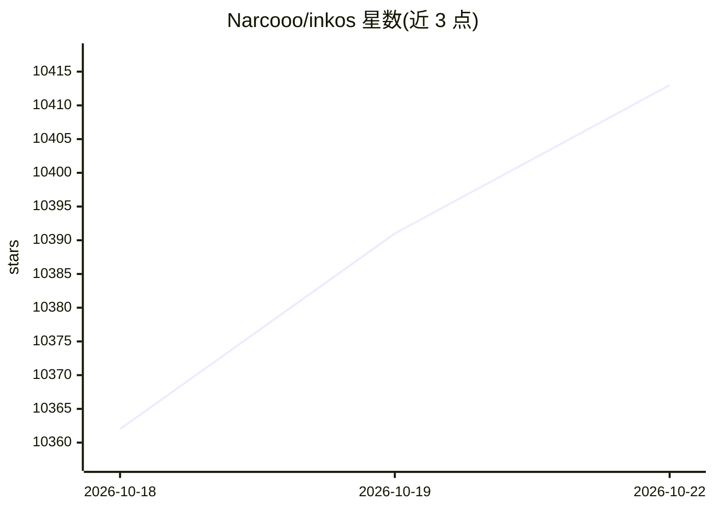

# Narcooo/inkos

⭐ 10,432 · TypeScript · AGPL-3.0 · 推送 2026-10-18 · [GitHub](https://github.com/Narcooo/inkos) · 个人维护 · 中文 README

**面向小说/剧本/互动影游创作的 AI Agent 写作系统**

InkOS 是故事创作与多语言翻译的 AI Agent 系统，覆盖长篇小说、短篇、剧本、分镜、互动影游、开放世界与翻译等创作形态，提供 Studio 网页工作台、TUI 与 CLI 三种交互入口。核心机制包括 pi-agent 统一执行 Harness、19 个内置专业 SKILL.md、SQLite FTS5/BM25 本地检索、章节级原子落盘与可恢复任务、剧情多线推演、定性审稿与去 AI 味、文风仿写、EPUB 导出。模型接入通过 provider bank 支持多家服务商与自定义端点，可被 Claude Code/OpenClaw 等 Agent 以 Skill 方式调用。需 Node.js 22.16+，v2.0 为开发版本分支。

## 筛选速览

| 维度 | 判定 | 备注 |
|---|---|---|
| AI 角色 | `ai-native` | 本体是模型或模型工具 |
| 许可风险 | `viral` | AGPL-3.0 |
| 部署形态 | `library` | 以包/库形式分发 |
| 模型依赖 | local-ok | 支持本地模型 |
| 硬件要求 | — | 无带数字的原话,不猜 |
| 安装摩擦 | `low` | 无编译、无系统依赖或容器化 |
| 成熟度 | `idea` | |

## 能力要点

- 长篇/短篇/剧本/分镜/互动影游/翻译共用一套 pi-agent 生产 Harness
- 19 个内置专业 SKILL.md 与 SQLite FTS5/BM25 统一本地检索
- 剧情多线推演、定性审稿、去 AI 味、文风仿写、EPUB 导出
- Studio / TUI / CLI / OpenClaw Skill 多入口，provider bank 内置多家模型服务

## 适用场景

- 用 AI 智能体连载长篇小说并跟踪角色、伏笔与状态
- 一键产出含大纲、简介、封面的完整短篇并导出 EPUB
- 通过自然语言定义并游玩开放世界或分支互动故事
- 把已有小说导入后继续 AI 续写

## 场景标签

`AI 写作` · 领域:内容生成

## 证据(README 行号)

> L17: InkOS 是一个面向故事创作与多语言翻译的 AI Agent 系统：长篇连载、独立短篇、剧本剧作、同人番外、仿写续写、互动影游、开放世界和长文翻译，都可以从同一个工作台开始。支持 Studio、TUI、CLI 交互形式，把创意、
> L4:  Story Creation AI Agent 面向长短篇小说、剧本剧作、互动影游、IP 内容与多语言翻译的创作智能体系统

## 星数曲线

2026-10-18 10,362 → 2026-10-22 10,413（+51）

---
*卡片 v1 · prompt 1.4 · 生成 2026-10-20 · 置信度 mid · 依据 README sha `418a8aba4564` · [字段定义](../../DATASET.md)*
