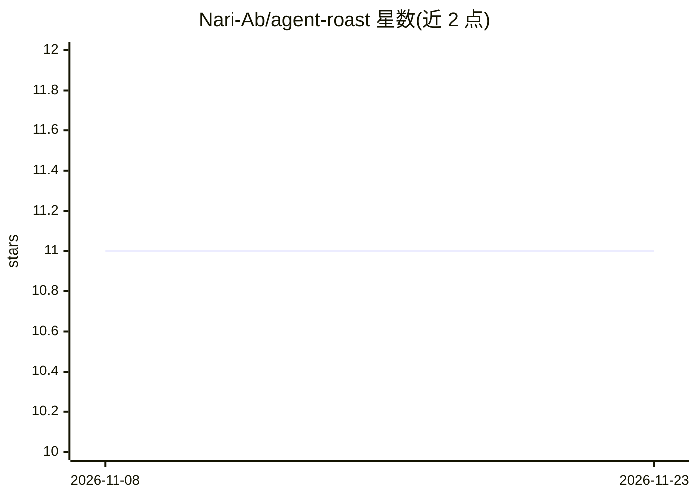

# Nari-Ab/agent-roast

⭐ 11 · TypeScript · MIT · 推送 2026-11-17 · [GitHub](https://github.com/Nari-Ab/agent-roast) · [官网](https://nari-ab.github.io/agent-roast/) · 个人维护

**拦截 AI 编码代理削弱测试或 CI 门槛的审查工具**

agent-roast 通过对比变更前后，捕获使构建变绿却非修复代码的改动：放宽断言、跳过或删除测试、降低覆盖率阈值、允许 CI 步骤失败。以代理 Stop hook、Git hook、pre-commit 与 GitHub Action 形式接入，对 Claude Code、Codex、Cursor 等代理的 hook 协议做了适配；发现弱化时将代理退回一次并附前后对照。确定性运行，无模型调用、无 token、离线。规则可经 .agentroastrc.json 配置，策略从 base 分支读取以防被变更本身关闭。README 自述 hook 未经长期真实会话测试，误报率有量化数据可查。

## 筛选速览

| 维度 | 判定 | 备注 |
|---|---|---|
| AI 角色 | `ai-ecosystem` | LLM/agent 周边工具 |
| 许可风险 | `permissive` | MIT |
| 部署形态 | `library` | 以包/库形式分发 |
| 模型依赖 | — | README 未给出锁定关系 |
| 硬件要求 | — | 无带数字的原话,不猜 |
| 安装摩擦 | `low` | 无编译、无系统依赖或容器化 |
| 成熟度 | — | 结构信号不足 |

## 能力要点

- before/after 对比检测断言弱化、测试跳过、门槛降低等 7 类规则
- 代理 hook 退回机制：一次退回+警告，不造成循环
- 策略从 HEAD/base 分支读取，变更无法自我放宽审查
- 离线确定性运行：无网络、无模型调用、不执行项目代码

## 适用场景

- 接入 Claude Code/Codex/Cursor 防止代理通过改测试让构建通过
- 在 GitHub Action 中对每个 PR 做检查弱化审查
- 用 replay 回放查看工具对历史提交会报什么

## 场景标签

`代码审查` · 领域:编码与开发

## 证据(README 行号)

> L11: **agent-roast** catches the changes that turn a red build green by weakening the *checks* instead of fixing the *co
> L29: npx agent-roast hook install          # Claude Code, Codex, Cursor, Gemini CLI, GitHub Copilot, Factory Droid, Kiro
> L137: - **Offline.** No network request, no model call, no telemetry; a test inspects the bundle for network modules.

## 星数曲线

2026-11-08 11 → 2026-11-23 11（+0）

---
*卡片 v1 · prompt 1.4 · 生成 2026-11-19 · 置信度 high · 依据 README sha `1d450fe6b4e4` · [字段定义](../../DATASET.md)*
