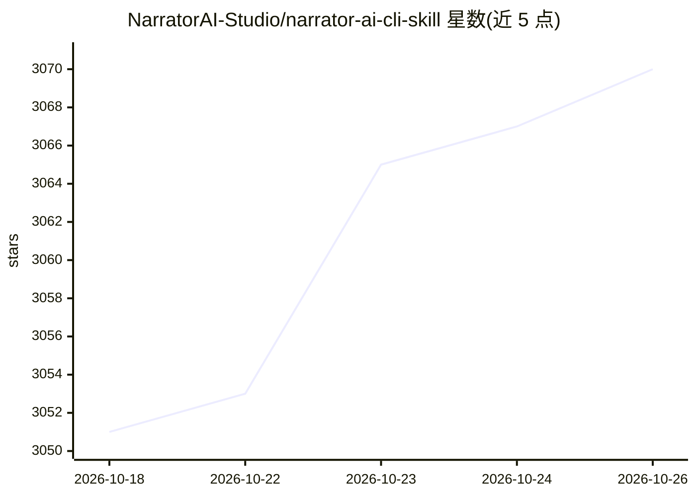

# NarratorAI-Studio/narrator-ai-cli-skill

⭐ 3,070 · MIT · 推送 2026-07-05 · [GitHub](https://github.com/NarratorAI-Studio/narrator-ai-cli-skill) · 组织维护 · 中文 README

**教 AI Agent 调用 narrator-ai-cli 自动生成电影解说视频的技能文件**

内容为 SKILL.md 技能文件及 references/ 目录，教会 Claude Code、Cursor、Windsurf、OpenClaw 等 Agent 如何调用 narrator-ai-cli 命令行工具，完成搜片→选模板→选 BGM→配音→生成脚本→合成视频的全流程。技能本身不含可执行命令，需先 pip 安装 CLI（v1.0.0+，Python 3.10+）并通过邮件获取 API key。内置约 100 部影片、146 首 BGM、63 个配音、90+ 模板资源表，覆盖 18 个 API 错误码的处理与预算预估。已在 9 个平台验证兼容。

## 筛选速览

| 维度 | 判定 | 备注 |
|---|---|---|
| AI 角色 | `ai-ecosystem` | LLM/agent 周边工具 |
| 许可风险 | `permissive` | MIT |
| 部署形态 | `library` | 以包/库形式分发 |
| 模型依赖 | — | README 未给出锁定关系 |
| 硬件要求 | — | 无带数字的原话,不猜 |
| 安装摩擦 | `low` | 无编译、无系统依赖或容器化 |
| 成熟度 | — | 结构信号不足 |

## 能力要点

- SKILL.md + references/ 技能文件，教 Agent 调用 narrator-ai-cli 全流程生成解说视频
- 两种工作流（改编解说/原创解说）与三种创作模式
- 内置资源查找表：约 100 部影片、146 首 BGM、63 个配音、90+ 解说模板
- 覆盖 18 个 API 错误码处理与任务前预算估算规则

## 适用场景

- 在我的编程 Agent 里用自然语言直接下单生成电影解说视频
- 批量制作不同影片的解说短视频
- 通过 Agent 调用语音克隆和文本转语音独立任务

## 场景标签

`视频生成` `语音合成` · 领域:内容生成

## 证据(README 行号)

> L9: A machine-readable skill file (`SKILL.md`) that teaches AI agents how to use the narrator-ai-cli tool for automated 
> L25: In short: **CLI is the hands. Skill is the brain.** Together, the AI agent can produce videos end-to-end.

## 星数曲线

2026-10-18 3,051 → 2026-10-26 3,070（+19）

---
*卡片 v1 · prompt 1.4 · 生成 2026-10-20 · 置信度 mid · 依据 README sha `b4b6a7d9b53e` · [字段定义](../../DATASET.md)*
