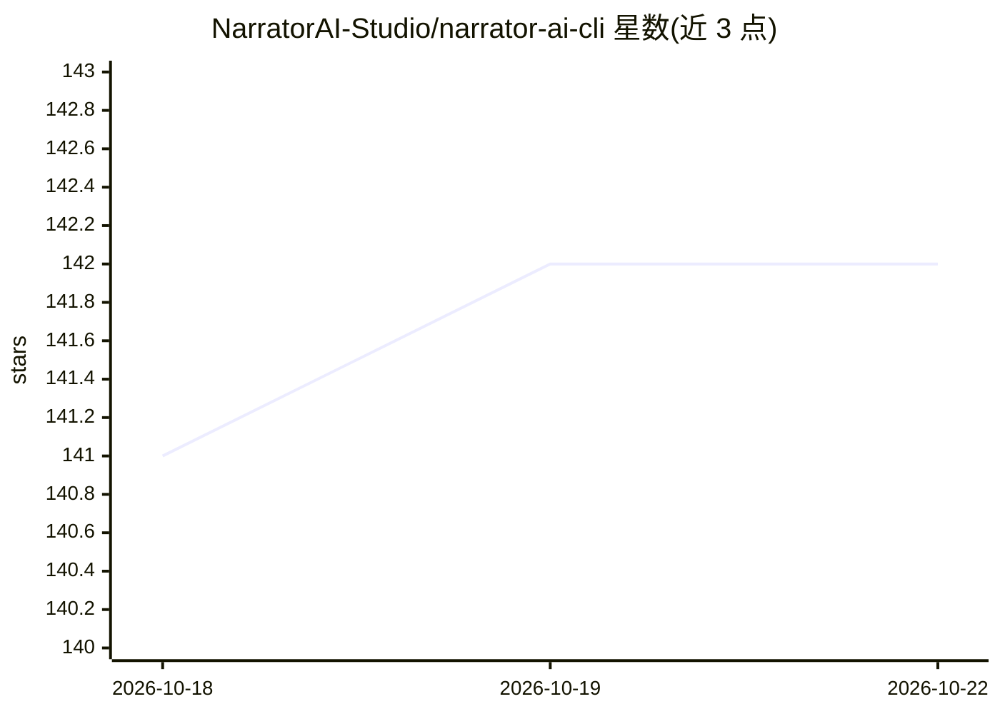

# NarratorAI-Studio/narrator-ai-cli

⭐ 144 · Python · MIT · 推送 2026-07-27 · [GitHub](https://github.com/NarratorAI-Studio/narrator-ai-cli) · 组织维护 · 中文 README

**电影解说视频生成平台的 CLI 客户端：一句话生成解说成片**

Narrator AI 平台的命令行客户端：通过自然语言指令或命令调用远端 API，自动完成选片、解说风格匹配、脚本生成、配音（63 音色/11 语言）、剪辑合成与下载链接输出；内置 93 部电影素材、146 条 BGM 与 90+ 解说模板，支持批量与无人值守生产。需向官方邮箱申请 API key，配额计费，生成本身在云端完成；可作为 Skill 安装到 OpenClaw、Windsurf 等 AI agent 中使用。

## 筛选速览

| 维度 | 判定 | 备注 |
|---|---|---|
| AI 角色 | `ai-native` | 本体是模型或模型工具 |
| 许可风险 | `permissive` | MIT |
| 部署形态 | `None` |  |
| 模型依赖 | — | README 未给出锁定关系 |
| 硬件要求 | — | 无带数字的原话,不猜 |
| 安装摩擦 | `low` | 无编译、无系统依赖或容器化 |
| 成熟度 | — | 结构信号不足 |

## 能力要点

- 一句话驱动完整管线：选片→风格→脚本→合成→下载链接
- 内置 93 部电影素材、146 条 BGM、63 配音音色、90+ 模板
- 支持批量生产与无人值守运行
- 全命令支持 --json 结构化输出，供 AI agent 调用

## 适用场景

- 让 AI agent 按一句话批量产出电影解说视频
- 通过终端管理解说任务、素材、配音与文件
- 短视频/解说内容创作者快速成片

## 场景标签

`视频生成` `语音合成` · 领域:内容生成

## 证据(README 行号)

> L9: Narrator AI CLI is the command-line tool for Narrator AI, an AI-powered video narration platform. Once installed in 
> L16: Select movie → Match narration style → Generate script → Compose video → Output download link
> L23: - ✅ **Movie narration videos**: Input a movie name, get a complete narration video (script + voiceover + footage + 

## 星数曲线

2026-10-18 141 → 2026-10-22 142（+1）

---
*卡片 v1 · prompt 1.4 · 生成 2026-10-22 · 置信度 high · 依据 README sha `2d045bcc6384` · [字段定义](../../DATASET.md)*
