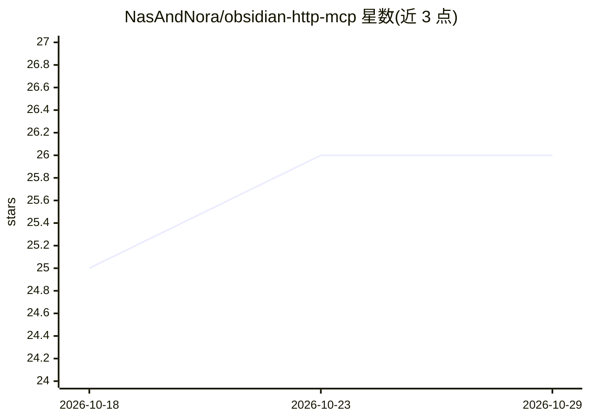

# NasAndNora/obsidian-http-mcp

⭐ 26 · TypeScript · MIT · 推送 2025-11-19 · [GitHub](https://github.com/NasAndNora/obsidian-http-mcp) · [官网](https://www.npmjs.com/package/obsidian-http-mcp) · 个人维护

**让 AI 客户端经 HTTP 管理 Obsidian 笔记的 MCP 服务器**

用 TypeScript 编写的 HTTP-native MCP 服务器，作为 MCP 协议与 Obsidian Local REST API 之间的翻译/代理层，使 Claude Code、Claude Desktop、Codex、Gemini 等 MCP 客户端能读取、创建、编辑、移动笔记，支持模糊查找与正则搜索。自称以 HTTP 传输规避 Claude Code CLI 的 stdio BrokenPipeError。通过 npm 全局安装，需本机运行 Obsidian 及其 Local REST API 插件与 Node.js 18+；默认绑定 0.0.0.0，README 明示仅适用于可信网络，不可直接暴露公网。软删除机制将误删文件移入 .trash-http-mcp/ 目录。

## 筛选速览

| 维度 | 判定 | 备注 |
|---|---|---|
| AI 角色 | `ai-ecosystem` | LLM/agent 周边工具 |
| 许可风险 | `permissive` | MIT |
| 部署形态 | `library` | 以包/库形式分发 |
| 模型依赖 | — | README 未给出锁定关系 |
| 硬件要求 | — | 无带数字的原话,不猜 |
| 安装摩擦 | `low` | 无编译、无系统依赖或容器化 |
| 成熟度 | — | 结构信号不足 |

## 能力要点

- HTTP-native MCP 服务器，在 MCP 协议与 Obsidian REST API 间翻译
- 支持模糊匹配查找与全库正则搜索
- 软删除保护（移入 .trash-http-mcp/）与防误删机制
- npm 全局安装，--setup 引导式配置，兼容 WSL2 跨环境连接

## 适用场景

- 在 Claude Code 等 MCP 客户端对话中直接管理 Obsidian 笔记库
- 绕开 Claude Code CLI 的 stdio 断管问题连接 Obsidian
- WSL2 上运行 AI、Windows 上运行 Obsidian 的跨环境工作流

## 场景标签

`知识库管理` · 领域:知识与检索

## 证据(README 行号)

> L5: The first HTTP-native MCP server for Obsidian that solves stdio transport bugs affecting Claude Code CLI (#3071, #91
> L188: > **Why not `127.0.0.1:27123` directly?** Port 27123 is Obsidian's REST API (custom HTTP protocol). Port 3000 is t

## 星数曲线

2026-10-18 25 → 2026-10-29 26（+1）

---
*卡片 v1 · prompt 1.4 · 生成 2026-10-26 · 置信度 high · 依据 README sha `29861991874f` · [字段定义](../../DATASET.md)*
