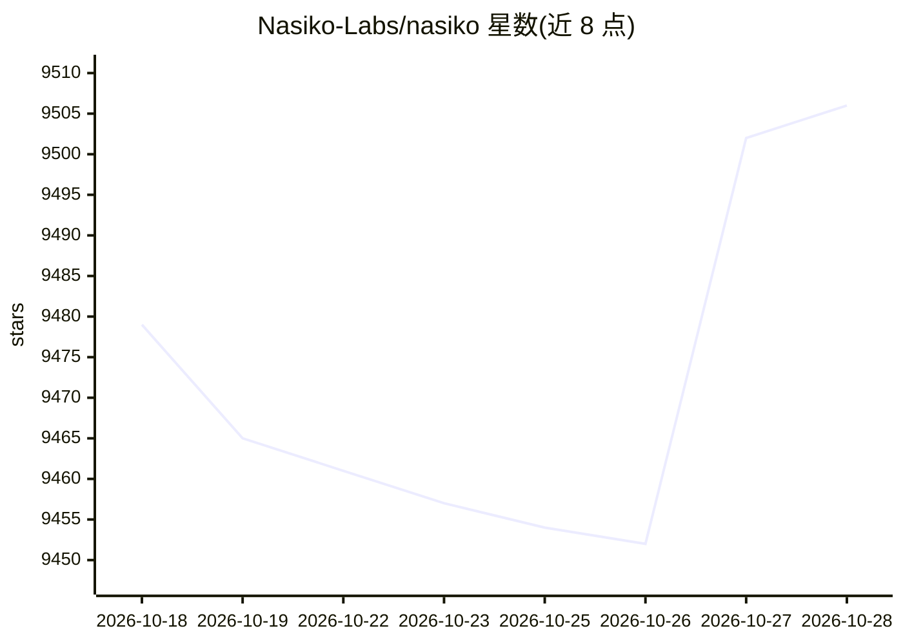

# Nasiko-Labs/nasiko

⭐ 10,189 · Rust · NOASSERTION · 推送 2026-10-23 · [GitHub](https://github.com/Nasiko-Labs/nasiko) · [官网](https://www.nasiko.com) · 组织维护

**AI 编码代理的开放运行时：发现、计费归因与模型路由**

用 Rust 编写的 agent 运行时与控制平面，面向已在使用 Claude Code、Codex、OpenCode、Cursor CLI 等编码代理的开发团队。核心机制：非侵入式发现本机已装的 harness（只读、不改配置、不联网上报），可选开启会话上报（通过各 harness 事件钩子本地排队后批量上传）与 LLM 路由（注册 provider 与 key，入站协议与出站 provider 解耦，如 Claude Code 的 Anthropic 格式请求由 OpenAI key 服务）。另有 TokenOps 成本/token 归因、MCP 网关、访问控制、A2A 部署与内嵌 OCI registry。路由与上报需控制平面与登录，CLI 通过 cargo 从源码安装。

## 筛选速览

| 维度 | 判定 | 备注 |
|---|---|---|
| AI 角色 | `ai-ecosystem` | LLM/agent 周边工具 |
| 许可风险 | `permissive` | NOASSERTION |
| 部署形态 | `desktop` | 安装包/桌面程序 |
| 模型依赖 | — | README 未给出锁定关系 |
| 硬件要求 | — | 无带数字的原话,不猜 |
| 安装摩擦 | `low` | 无编译、无系统依赖或容器化 |
| 成熟度 | `idea` | |

## 能力要点

- 只读发现本机已装编码代理，不改 harness 配置
- 入站协议与出站 provider 解耦的 LLM 路由，代理与日志不接触真实 API key
- 按 agent/按模型的成本与 token 归因（基于 gen_ai.* span 与 OTel trace）
- MCP 网关：单一 URL 输出经权限过滤的合并工具视图

## 适用场景

- 统一查看团队各编码代理的花费归属与模型使用
- 把 Claude Code 等工具的流量路由到自己选定的 LLM provider
- 对 agent 间调用做代理、权限控制与级联限流

## 场景标签

`模型网关` `LLM 可观测性` · 领域:Agent 开发

## 证据(README 行号)

> L3: **Nasiko is the OpenRuntime for agents, coding harnesses, frameworks and tools.**
> L27: Nasiko finds those agents, puts their spend in one schema, and hands back the model choice the
> L184: |**LLM Router**|Agents get an `OPENAI_BASE_URL` and a short-lived identity token instead of a real key. The router

## 星数曲线

2026-10-18 9,479 → 2026-10-28 9,506（+27）

---
*卡片 v1 · prompt 1.4 · 生成 2026-10-20 · 置信度 mid · 依据 README sha `08c54c2e2103` · [字段定义](../../DATASET.md)*
