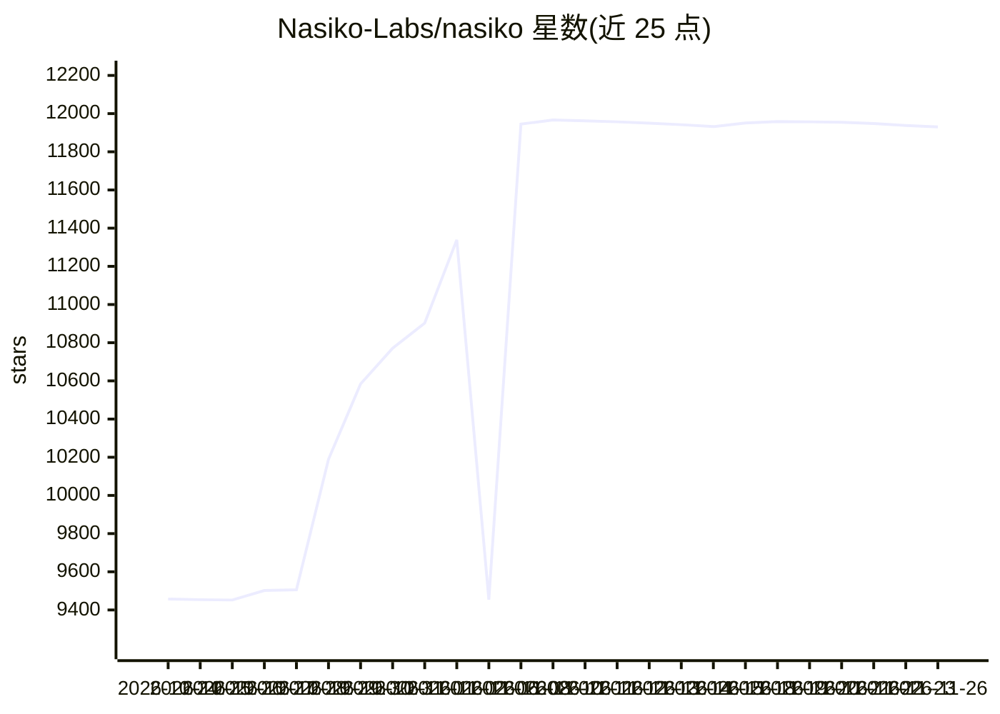

# Nasiko-Labs/nasiko

⭐ 11,930 · Rust · NOASSERTION · 推送 2026-11-25 · [GitHub](https://github.com/Nasiko-Labs/nasiko) · [官网](https://www.nasiko.com) · 组织维护

**AI Agent 开放运行时：统计开销、路由模型、部署治理**

以单一服务器进程形式运行的 Agent 运行时，定位在 Agent 调用链路上：发现机器上的 Claude Code、Codex、OpenCode、Cursor CLI 并汇总其 token 与成本；提供 LLM Router（Agent 只持短期 token，不持真实 API key）、按 Agent/模型的成本归因、OTel 全链路追踪；治理侧含 MCP Gateway、访问控制、人工审批与流程防护；支持部署任意 A2A v1.0 Agent。服务器需 Docker Compose 运行，状态存于 Postgres、Redis、S3。

## 筛选速览

| 维度 | 判定 | 备注 |
|---|---|---|
| AI 角色 | `ai-ecosystem` | LLM/agent 周边工具 |
| 许可风险 | `permissive` | NOASSERTION |
| 部署形态 | `self-host` | docker 或自建部署 |
| 模型依赖 | — | README 未给出锁定关系 |
| 硬件要求 | — | 无带数字的原话,不猜 |
| 安装摩擦 | `low` | 无编译、无系统依赖或容器化 |
| 成熟度 | — | 结构信号不足 |

## 能力要点

- 发现本机 coding agent 并把 token 与成本汇入单一仪表盘
- LLM Router：Agent 获取短期 token，密钥在服务器端解析
- MCP Gateway 统一发放工具，凭据留在网关侧
- 人工审批（ask）与深度/扇出/预算/循环等流程防护

## 适用场景

- 统计团队各 coding agent 在各模型上的花费
- 用自己的模型 key 驱动现有 coding agent
- 部署自研 A2A Agent 并控制其工具权限与预算

## 场景标签

`模型网关` · 领域:Agent 开发

## 证据(README 行号)

> L3: **Nasiko is the OpenRuntime for AI agents.**
> L4: See every coding agent your team runs and what it costs. Route it to the models you choose. Then deploy and govern y
> L50: |**LLM Router**|Agents get a short-lived token, never a real API key. Provider, model and key are resolved on the s

## 星数曲线

2026-10-24 9,457 → 2026-11-26 11,930（+2,473）

---
*卡片 v1 · prompt 1.4 · 生成 2026-11-26 · 置信度 high · 依据 README sha `e922c33bb7ef` · [字段定义](../../DATASET.md)*
