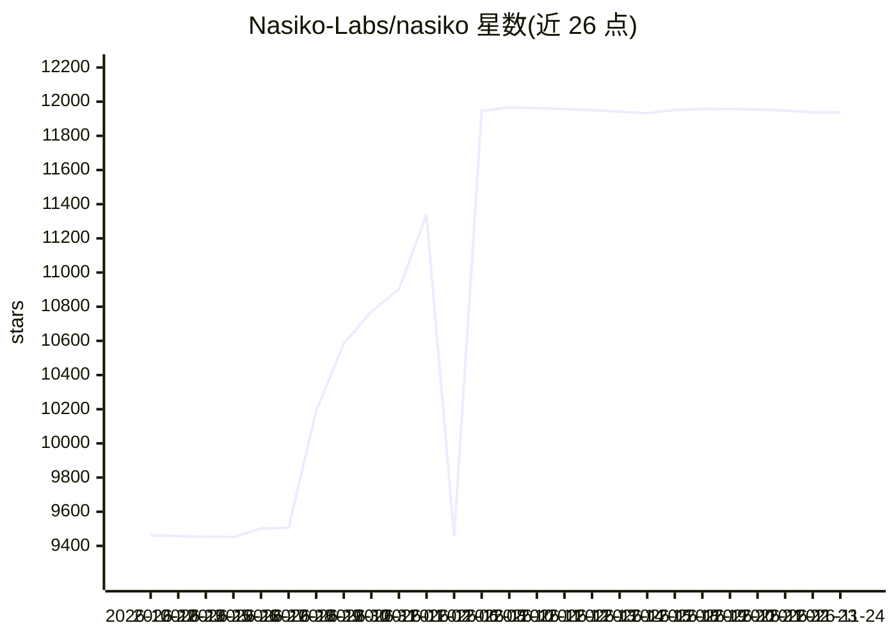

# Nasiko-Labs/nasiko

⭐ 11,938 · Rust · NOASSERTION · 推送 2026-11-18 · [GitHub](https://github.com/Nasiko-Labs/nasiko) · [官网](https://www.nasiko.com) · 组织维护

**团队 coding agent 的运行时：发现、成本归集、模型路由与部署治理**

以单一服务进程形式运行的 AI agent 开放运行时，定位在 agent 调用发生的路径上：发现机器上的 Claude Code、Codex、OpenCode、Cursor CLI，把各 harness 的 token 用量与成本汇入同一仪表盘；通过 LLM Router 让 harness 使用短效 token 而非真实 API key，实现按 agent/model 的成本归因；提供 MCP Gateway 管理工具凭证、访问控制、人工审批（ask 规则）、深度/预算流控；支持部署任何符合 A2A v1.0 的 agent（Python/Rust/Go/TypeScript），内置 S3 后端 OCI registry。非侵入：上报与路由均为可选项。

## 筛选速览

| 维度 | 判定 | 备注 |
|---|---|---|
| AI 角色 | `ai-ecosystem` | LLM/agent 周边工具 |
| 许可风险 | `permissive` | NOASSERTION |
| 部署形态 | `self-host` | docker 或自建部署 |
| 模型依赖 | — | README 未给出锁定关系 |
| 硬件要求 | — | 无带数字的原话,不猜 |
| 安装摩擦 | `low` | 无编译、无系统依赖或容器化 |
| 成熟度 | — | 结构信号不足 |

## 能力要点

- 发现本机 coding agent 并导入历史会话，只读不改动
- LLM Router：agent 持短效 token，真实 API key 留在服务端加密
- MCP Gateway 统一下发工具，支持 allow/ask/block 与人工审批暂停
- nasiko deploy 构建并运行 A2A agent，无专有格式与 SDK

## 适用场景

- 团队月底要知道谁在哪个模型上花了多少钱
- 让 Claude Code 改用自有的 OpenAI key 出请求
- 给部署的 agent 接 GitHub 工具并限制危险操作需人工审批

## 场景标签

`模型网关` · 领域:Agent 开发

## 证据(README 行号)

> L3: **Nasiko is the OpenRuntime for AI agents.**
> L4: See every coding agent your team runs and what it costs. Route it to the models you choose. Then deploy and govern y
> L77: calls happen. So it runs as a **single server process** that every agent call passes through, with

## 星数曲线

2026-10-22 9,461 → 2026-11-24 11,938（+2,477）

---
*卡片 v1 · prompt 1.4 · 生成 2026-11-22 · 置信度 high · 依据 README sha `8eb76128de13` · [字段定义](../../DATASET.md)*
