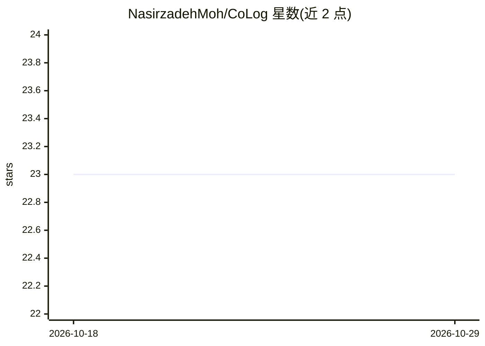

# NasirzadehMoh/CoLog

⭐ 23 · Python · MIT · 推送 2026-01-28 · [GitHub](https://github.com/NasirzadehMoh/CoLog) · [官网](https://alarmif.com) · 组织维护

**检测操作系统日志中点异常与集体异常的协同 Transformer 框架**

论文 "A Unified Framework for Detecting Point and Collective Anomalies in Operating System Logs via Collaborative Transformers" 的官方实现：将多模态情感分析方法迁移到日志异常检测，用协同 Transformer 与多头 impressed attention 编码多种日志模态间的交互，含模态适配层（MAL）与平衡层。在 Casper、Jhuisi、Nssal、Honey7、Zookeeper、Hadoop、BGL 七个基准数据集上评估点异常与集体异常检测。需 Python 3.8+，git clone 后 pip 安装依赖并下载 spaCy 语言模型，训练建议使用 CUDA GPU。

## 筛选速览

| 维度 | 判定 | 备注 |
|---|---|---|
| AI 角色 | `ai-native` | 本体是模型或模型工具 |
| 许可风险 | `permissive` | MIT |
| 部署形态 | `library` | 以包/库形式分发 |
| 模型依赖 | — | README 未给出锁定关系 |
| 硬件要求 | — | 无带数字的原话,不猜 |
| 安装摩擦 | `medium` | 含编译或系统依赖之一 |
| 成熟度 | — | 结构信号不足 |

## 能力要点

- 协同 Transformer 与多头 impressed attention 编码多日志模态交互
- 模态适配层与平衡层处理模态异质性与影响调节
- 统一框架同时检测点异常与集体异常
- 在七个日志异常检测基准数据集上评估

## 适用场景

- 在系统日志（Hadoop/BGL/Zookeeper 等）上训练并检测异常
- 复现论文的点异常与集体异常检测实验
- 安全监控与系统运维场景的日志分析研究

## 场景标签

 · 领域:日志分析/异常检测

## 证据(README 行号)

> L10:  Official implementation of "A Unified Framework for Detecting Point and Collective Anomalies in Operating System L
> L20: Log anomaly detection is crucial for preserving the security of operating systems. Depending on the source of log d

## 星数曲线

2026-10-18 23 → 2026-10-29 23（+0）

---
*卡片 v1 · prompt 1.4 · 生成 2026-10-27 · 置信度 mid · 依据 README sha `929c51cb7ad5` · [字段定义](../../DATASET.md)*
