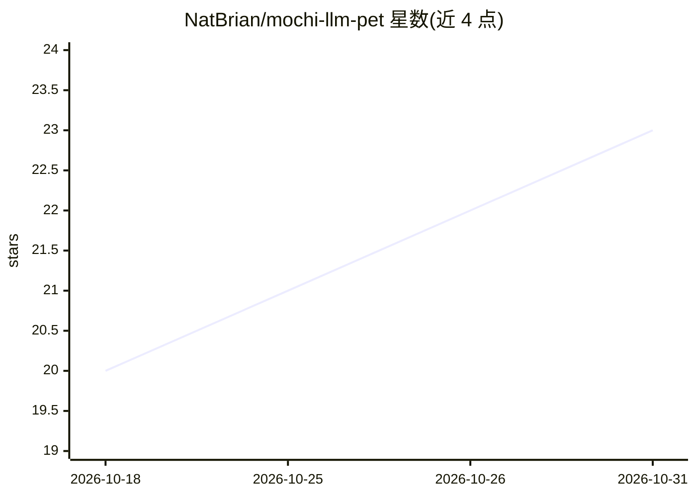

# NatBrian/mochi-llm-pet

⭐ 23 · Python · 推送 2026-06-11 · [GitHub](https://github.com/NatBrian/mochi-llm-pet) · 个人维护

**Windows 桌面 AI 宠物：像素猫由多模态 LLM 驱动，看屏幕并拟猫反应**

用 Python/PyQt6 编写的透明置顶桌面宠物猫：Win32 传感器持续读取窗口布局、光标、前台应用，每次决策把整屏截图与蒸馏场景文本发给一个多模态 LLM（默认本地 Ollama，也支持 Gemini/OpenAI/Anthropic/OpenAI 兼容端点），模型输出结构化意图（动词/目标/情绪/台词），由 60fps 渲染循环执行为走动、扑光标、趴窗沿、打盹等行为。记忆存于 SQLite，能量/心情/羁绊跨会话持久；LLM 不可达时回退到规则行为。面向终端用户，仅限 Windows，从源码运行。

## 筛选速览

| 维度 | 判定 | 备注 |
|---|---|---|
| AI 角色 | `ai-native` | 本体是模型或模型工具 |
| 许可风险 | `none` | — |
| 部署形态 | `desktop` | 安装包/桌面程序 |
| 模型依赖 | local-ok | 支持本地模型 |
| 硬件要求 | — | 无带数字的原话,不猜 |
| 安装摩擦 | `low` | 无编译、无系统依赖或容器化 |
| 成熟度 | — | 结构信号不足 |

## 能力要点

- 多模态 LLM 基于整屏截图与场景文本决定宠物行为，输出结构化意图
- 默认本地 Ollama（gemma4:12b），截图不离开本机；支持 5 种可切换提供方
- SQLite 持久化事实/情景记忆与能量/心情/羁绊状态，性格跨会话演化
- LLM 不可达时自动回退规则行为，内置占位猫素材，无艺术资源也可运行

## 适用场景

- 在桌面养一只会观察屏幕、追踪光标并说话的 AI 猫
- 用本地 Ollama 做大脑，隐私地运行屏幕感知宠物
- 通过抚摸/戳/扔等鼠标手势与宠物互动并培养羁绊

## 场景标签

 · 领域:桌面应用/AI 陪伴

## 证据(README 行号)

> L5: **Mochi is an AI desktop pet / desktop mascot driven by a multimodal LLM.** A
> L7: layout, cursor, the active app — and a single vision LLM (local **Ollama**, or
> L51: Sensors (ms, Win32)  ─►  WorldState  ─►  [trigger]  ─►  ONE multimodal LLM

## 星数曲线

2026-10-18 20 → 2026-10-31 23（+3）

---
*卡片 v1 · prompt 1.4 · 生成 2026-10-27 · 置信度 high · 依据 README sha `f4d44545ee9a` · [字段定义](../../DATASET.md)*
