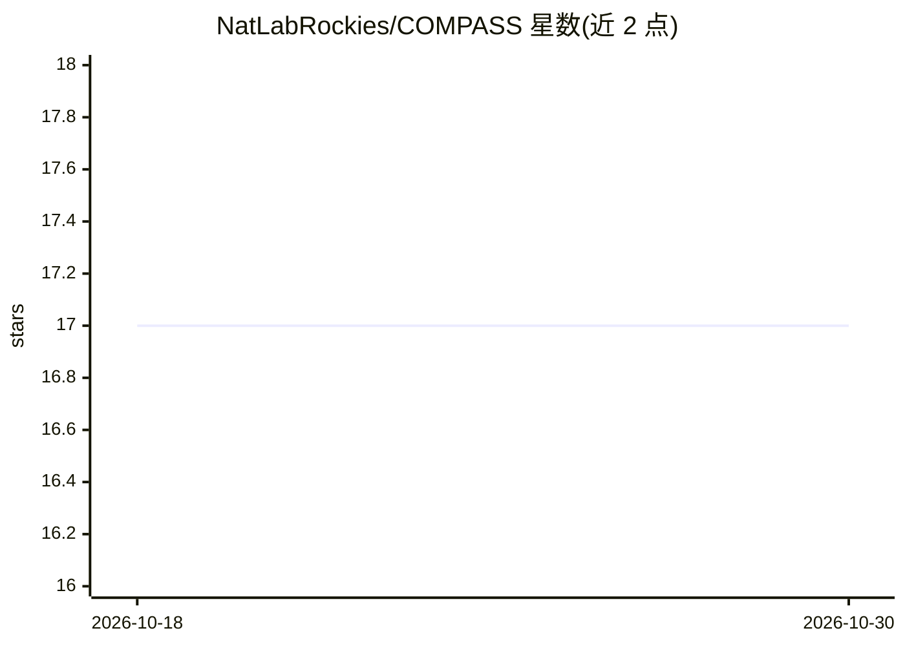

# NatLabRockies/COMPASS

⭐ 17 · Python · BSD-3-Clause · 推送 2026-10-27 · [GitHub](https://github.com/NatLabRockies/COMPASS) · [官网](https://natlabrockies.github.io/COMPASS/) · 组织维护

**用 LLM 汇编能源法规条例清单的工具：检索并抽取结构化数据**

面向能源基础设施选址与许可场景的 Python 工具：按辖区检索州与地方法规条例文档，调用 LLM（如 gpt-4o-mini）从中抽取退距、高度限制、噪声阈值等结构化数据，存入可版本化数据库并导出 CSV、Excel 或 GeoPackage。LLM 调用外围设有幻觉校验（文本与源文档比对、漂移过大即丢弃）、来源 URL 溯源与低成本启发式预过滤。数据集每年运行并发布至 OpenEI。需自备 OpenAI API key 运行演示。

## 筛选速览

| 维度 | 判定 | 备注 |
|---|---|---|
| AI 角色 | `ai-native` | 本体是模型或模型工具 |
| 许可风险 | `permissive` | BSD-3-Clause |
| 部署形态 | `library` | 以包/库形式分发 |
| 模型依赖 | — | README 未给出锁定关系 |
| 硬件要求 | — | 无带数字的原话,不猜 |
| 安装摩擦 | `low` | 无编译、无系统依赖或容器化 |
| 成熟度 | — | 结构信号不足 |

## 能力要点

- 检索条例文档并抽取结构化数据入版本化数据库
- 幻觉防线：抽取文本与源文档比对，漂移过大即丢弃
- 每条记录携带来源 URL 可审计
- 启发式预过滤在 LLM 调用前剔除无关文本以控制成本

## 适用场景

- 为选址与容量建模（如 reV、GIS 流程）获取条例数值数据
- 批量抽取数百个辖区的退距、限高、噪声条款
- 审计或抽查已发布条例数据集的原始出处

## 场景标签

`网页抓取` `文档解析` · 领域:效率与自动化

## 证据(README 行号)

> L30: is an innovative software tool that harnesses the power of Large Language
> L34: At a high level, COMPASS does two things: it *retrieves* the right ordinance
> L35: documents for each jurisdiction you ask about, and then *extracts* structured data from

## 星数曲线

2026-10-18 17 → 2026-10-30 17（+0）

---
*卡片 v1 · prompt 1.4 · 生成 2026-10-30 · 置信度 high · 依据 README sha `4cbf352a515f` · [字段定义](../../DATASET.md)*
