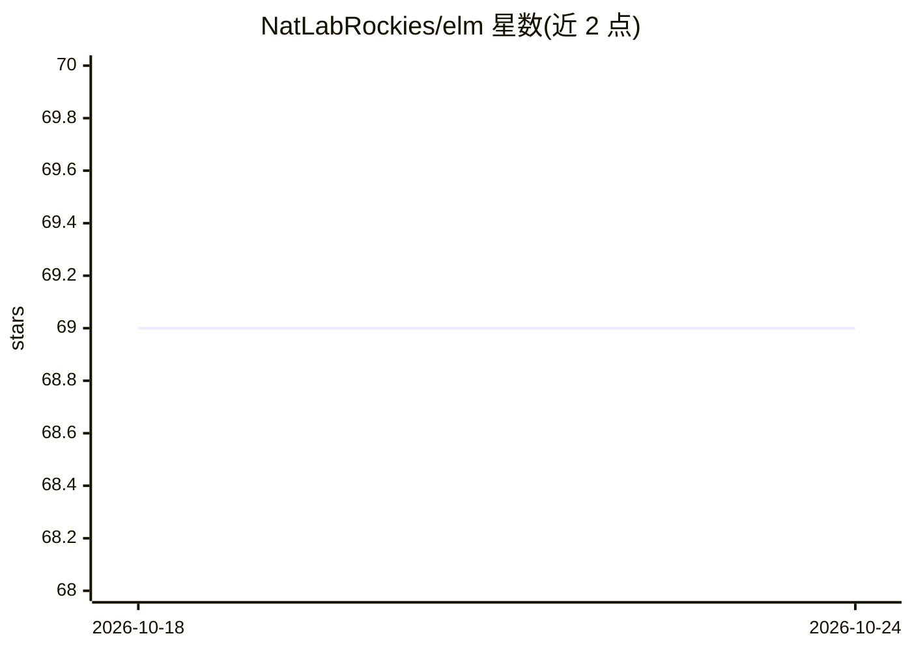

# NatLabRockies/elm

⭐ 69 · Python · BSD-3-Clause · 推送 2026-10-07 · [GitHub](https://github.com/NatLabRockies/elm) · [官网](https://natlabrockies.github.io/elm/) · 组织维护

**面向能源研究的 LLM 应用工具库：PDF 转文本、嵌入、摘要与数据抽取**

由美国落基山国家实验室（DOE 资助）开发的开源 Python 库，提供将 ChatGPT、GPT-4 等大语言模型应用于能源研究的接口：把 PDF 转为文本数据库、文档分块并嵌入向量数据库、递归文档摘要、基于决策树构建自动化数据抽取流程，以及对接 OSTI 报告的问答应用示例。通过 PyPI（NLR-elm）安装， ordinances 抓取与抽取功能另有专门安装说明；开发者可通过 git clone 加 conda 环境从源码安装。

## 筛选速览

| 维度 | 判定 | 备注 |
|---|---|---|
| AI 角色 | `ai-ecosystem` | LLM/agent 周边工具 |
| 许可风险 | `permissive` | BSD-3-Clause |
| 部署形态 | `library` | 以包/库形式分发 |
| 模型依赖 | — | README 未给出锁定关系 |
| 硬件要求 | — | 无带数字的原话,不猜 |
| 安装摩擦 | `low` | 无编译、无系统依赖或容器化 |
| 成熟度 | — | 结构信号不足 |

## 能力要点

- PDF 转文本数据库与文档分块嵌入向量数据库
- 递归文档摘要（elm.summary.Summary）
- 基于决策树的自动化数据抽取工作流
- 含对接 OSTI 报告的问答应用示例

## 适用场景

- 能源研究人员把报告类 PDF 转为可检索的文本/向量数据库
- 对长文档做递归摘要与结构化数据抽取
- 搭建面向能源文献的问答应用

## 场景标签

`文档解析` `文档问答` `科研工具` · 领域:知识与检索

## 证据(README 行号)

> L21: The Energy Language Model (ELM) software provides interfaces to apply Large Language Models (LLMs) like ChatGPT and
> L57: This work was authored by the National Laboratory of the Rockies, operated by Alliance for Energy Innovation, LLC, 

## 星数曲线

2026-10-18 69 → 2026-10-24 69（+0）

---
*卡片 v1 · prompt 1.4 · 生成 2026-10-24 · 置信度 mid · 依据 README sha `f3b6e4615d5e` · [字段定义](../../DATASET.md)*
