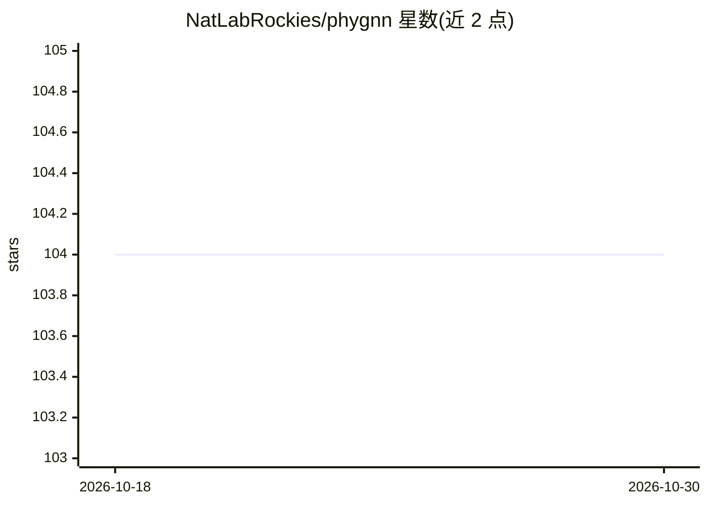

# NatLabRockies/phygnn

⭐ 104 · Python · BSD-3-Clause · 推送 2026-10-27 · [GitHub](https://github.com/NatLabRockies/phygnn) · [官网](https://natlabrockies.github.io/phygnn/) · 组织维护

**物理引导神经网络框架：让 NN 训练遵循物理约束**

由 NREL（美国国家可再生能源实验室）开发的 Python 框架，在传统神经网络损失函数上叠加通用物理损失项，引导网络学习物理或理论约束，用于物理与工程场景的机器学习建模。支持回归、分类及 GAN 示例，可经 Binder 免费在线运行示例。NLR 用其以辐射传输模型作物理损失项预测云光学属性与辐照度。提供 conda/pip 安装与开发者源码安装流程。

## 筛选速览

| 维度 | 判定 | 备注 |
|---|---|---|
| AI 角色 | `ai-native` | 本体是模型或模型工具 |
| 许可风险 | `permissive` | BSD-3-Clause |
| 部署形态 | `library` | 以包/库形式分发 |
| 模型依赖 | — | README 未给出锁定关系 |
| 硬件要求 | — | 无带数字的原话,不猜 |
| 安装摩擦 | `low` | 无编译、无系统依赖或容器化 |
| 成熟度 | — | 结构信号不足 |

## 能力要点

- 在损失函数中叠加可自定义的物理/理论约束项
- 支持回归、分类与 GAN 应用示例 notebook
- 可通过 Binder 在云端免费运行示例
- 物理损失可基于经验观测调整理论模型（按损失权重）

## 适用场景

- 让深度网络输出满足物理一致性（如湖温建模）
- 用物理损失扩展训练数据（对预测变量的下游应用做训练）
- 实现自定义正则化（如拓扑正则化）

## 场景标签

`模型训练` · 领域:训练与推理

## 证据(README 行号)

> L34: This implementation of physics-guided neural networks augments a traditional
> L37: phygnn enables scientific software developers and data scientists to easily
> L53: At NLR, we are using the phygnn framework

## 星数曲线

2026-10-18 104 → 2026-10-30 104（+0）

---
*卡片 v1 · prompt 1.4 · 生成 2026-10-23 · 置信度 high · 依据 README sha `5a3201663485` · [字段定义](../../DATASET.md)*
