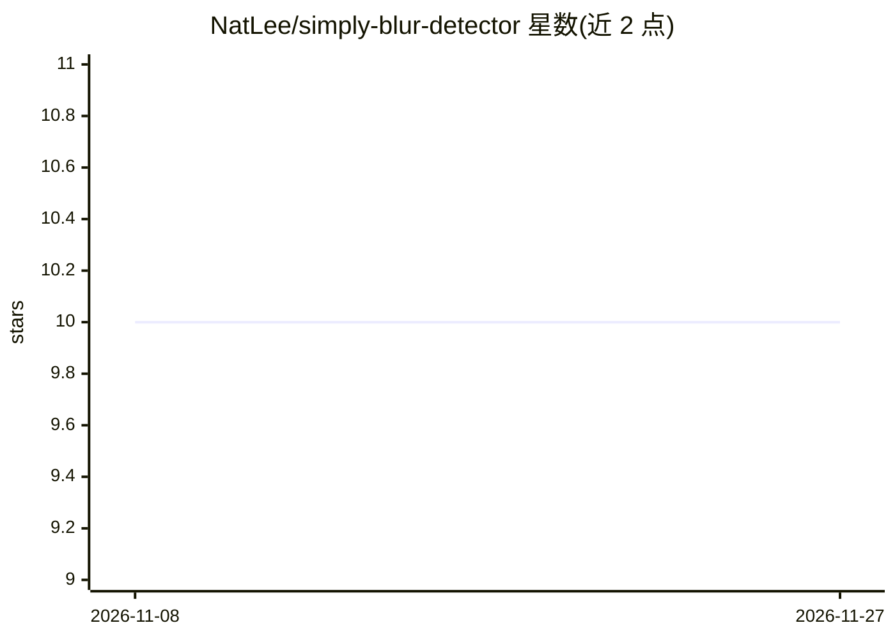

# NatLee/simply-blur-detector

⭐ 10 · Python · MIT · 推送 2026-11-05 · [GitHub](https://github.com/NatLee/simply-blur-detector) · [官网](https://natlee.github.io/simply-blur-detector/) · 个人维护

**给需要区分清晰/模糊图片的开发者的轻量 CNN 模糊检测工具**

一个 Keras 小型卷积神经网络（约 10 万参数），训练流程为：准备清晰图片，用 blur-generator 生成镜头/高斯/运动模糊副本，再训练模型输出 P(blur)。仓库自带 120 张插画及模糊副本可直接训练，也支持用户放入自己的图片。全流程以 Docker Compose 交付，模型可导出为 ONNX 并在浏览器端以 ONNX Runtime Web 运行演示页，展示逐窗口热力图并与传统 Laplacian 方差法对照；CI 设有 85% 测试准确率发布门槛。MIT 许可，支持 x86-64 与 ARM64。

## 筛选速览

| 维度 | 判定 | 备注 |
|---|---|---|
| AI 角色 | `ai-native` | 本体是模型或模型工具 |
| 许可风险 | `permissive` | MIT |
| 部署形态 | `self-host` | docker 或自建部署 |
| 模型依赖 | — | README 未给出锁定关系 |
| 硬件要求 | — | 无带数字的原话,不猜 |
| 安装摩擦 | `low` | 无编译、无系统依赖或容器化 |
| 成熟度 | — | 结构信号不足 |

## 能力要点

- CNN 输出整图 P(blur) 与逐窗口模糊热力图，并与无需训练的 Laplacian 方差并排对照
- blur-generator 自动生成镜头/高斯/运动三种模糊副本用于训练
- 模型导出 ONNX 后在浏览器内运行，图片不离开本地
- CI 校验模型测试准确率不低于 85% 且与 Python 输出一致后才发布

## 适用场景

- 批量判断图片是否模糊并输出概率值供脚本使用
- 在浏览器里对单张图片查看模糊区域热力图
- 用自己的清晰图片训练专属模糊检测模型

## 场景标签

`图像视频处理` `目标检测` · 领域:感知与多模态

## 证据(README 行号)

> L11: A small convolutional neural network (CNN) that tells sharp pictures from blurry ones. You train it on a
> L17: **web demo**: drop a picture and it shows the
> L35: probability of "Clear" and "Blur".

## 星数曲线

2026-11-08 10 → 2026-11-27 10（+0）

---
*卡片 v1 · prompt 1.4 · 生成 2026-11-20 · 置信度 high · 依据 README sha `7b551ba7be88` · [字段定义](../../DATASET.md)*
