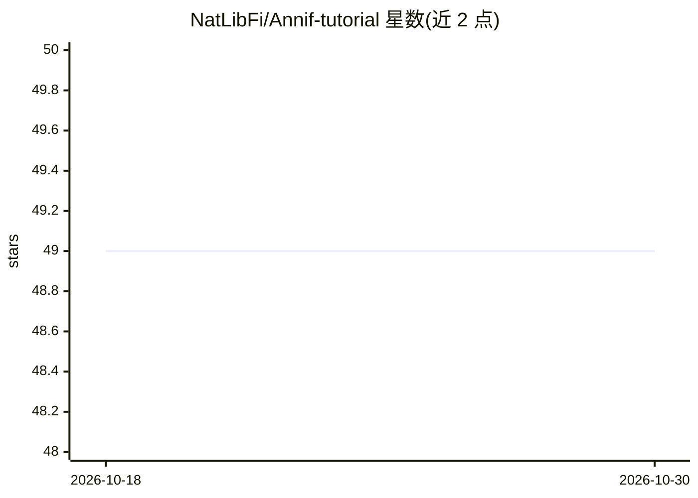

# NatLibFi/Annif-tutorial

⭐ 49 · Jupyter Notebook · CC-BY-4.0 · 推送 2026-07-20 · [GitHub](https://github.com/NatLibFi/Annif-tutorial) · 组织维护

**图书馆员/开发者的 Annif 自动主题标引教学材料**

由芬兰国家图书馆等机构人员制作的 Annif 工具动手教程：包含视频讲解与系列练习，覆盖 Annif 安装（VirtualBox/Docker/GitHub Codespaces）、TFIDF/MLLM/Omikuji/fastText/集成模型等算法项目、Web UI 与 REST API、评测指标、多语言处理、arXiv 语料构建、DVC 流水线及从 Hugging Face Hub 下载现成项目。提供 yso-nlf 与 stw-zbw 两个示例数据集，需 8GB 内存与 20GB 磁盘；Annif 本身的安装是练习内容之一，材料可自学使用。

## 筛选速览

| 维度 | 判定 | 备注 |
|---|---|---|
| AI 角色 | `ai-knowledge` | 知识聚合/清单类 |
| 许可风险 | `viral` | CC-BY-4.0 |
| 部署形态 | `None` |  |
| 模型依赖 | — | README 未给出锁定关系 |
| 硬件要求 | — | 无带数字的原话,不猜 |
| 安装摩擦 | `low` | 无编译、无系统依赖或容器化 |
| 成熟度 | — | 结构信号不足 |

## 能力要点

- 视频讲座加动手练习覆盖 Annif 安装到生产部署全流程
- 两个示例数据集（yso-nlf、stw-zbw）与自动化 make 下载脚本
- 练习覆盖 TFIDF/MLLM/Omikuji/fastText/神经网络集成等多种算法
- 支持 GitHub Codespaces 远程环境，无需本地安装

## 适用场景

- 自学如何在图书馆/档案场景用 Annif 做自动主题标引
- 培训机构或研讨会使用现成 GLAM 主题标引工作坊材料
- 练习用 DVC 与 Hugging Face Hub 管理 Annif 模型项目

## 场景标签

`教程课程` · 领域:学习与行业

## 证据(README 行号)

> L3: The tutorial includes short **video presentations** and **hands-on exercises**
> L4: to help you learn how to use the Annif tool for automated subject indexing and classification.
> L78: # Exercises and videos

## 星数曲线

2026-10-18 49 → 2026-10-30 49（+0）

---
*卡片 v1 · prompt 1.4 · 生成 2026-10-24 · 置信度 high · 依据 README sha `1cc7b63e64a1` · [字段定义](../../DATASET.md)*
