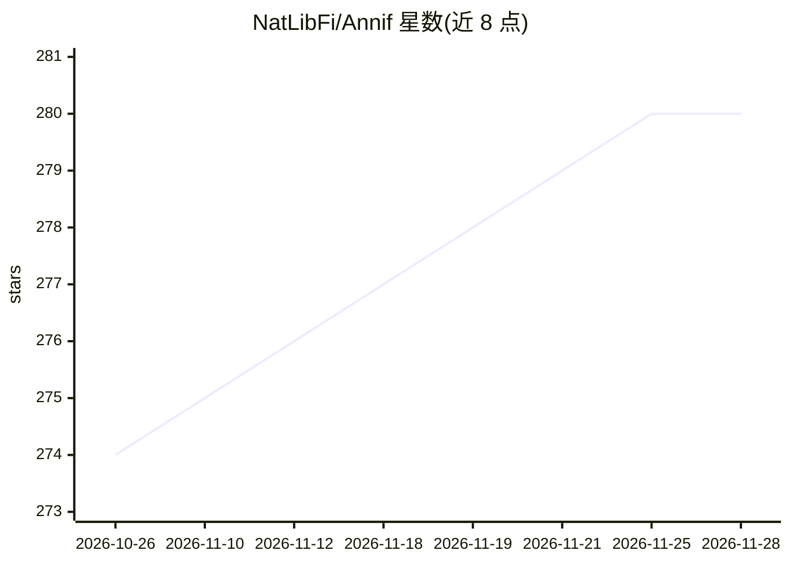

# NatLibFi/Annif

⭐ 280 · Python · NOASSERTION · 推送 2026-11-24 · [GitHub](https://github.com/NatLibFi/Annif) · [官网](https://annif.org) · 组织维护

**为图书馆、档案馆、博物馆自动生成主题标引的工具包**

Annif 是一个多算法自动主题标引工具包，最初基于 Finna.fi 发现界面的元数据作为训练语料构建。它提供管理用的 CLI 命令，以及面向最终用户的 REST API 和 Web UI；基于 Finto AI 的服务即构建于 Annif 之上，其使用的模型发布在 Hugging Face Hub 集合中。支持 fastText、Omikuji 等后端与 Voikko、spaCy 分析器作为可选依赖，在 Linux 上开发测试，Windows/macOS 建议通过 Docker 或 Linux 虚拟机运行。

## 筛选速览

| 维度 | 判定 | 备注 |
|---|---|---|
| AI 角色 | `ai-native` | 本体是模型或模型工具 |
| 许可风险 | `none` | NOASSERTION |
| 部署形态 | `library` | 以包/库形式分发 |
| 模型依赖 | — | README 未给出锁定关系 |
| 硬件要求 | — | 无带数字的原话,不猜 |
| 安装摩擦 | `low` | 无编译、无系统依赖或容器化 |
| 成熟度 | — | 结构信号不足 |

## 能力要点

- 多算法自动主题标引与多标签分类
- 提供 CLI、REST API 与 Web UI 三种使用形式
- 可选 fastText、Omikuji、PyTorch 等后端及 Voikko、spaCy 分析器
- bash/zsh/fish shell 的 tab 补全支持

## 适用场景

- 为图书馆元数据自动生成主题标引
- 通过 REST API 在馆藏系统中集成自动分类
- 对瑞典语等图书馆元数据做杜威十进制分类

## 场景标签

 · 领域:图书情报/文本分类

## 证据(README 行号)

> L14: Annif is an automated subject indexing toolkit. It was originally created as
> L18: Annif provides CLI commands for administration, and a REST API and web UI for end-users.

## 星数曲线

2026-10-26 274 → 2026-11-28 280（+6）

---
*卡片 v1 · prompt 1.4 · 生成 2026-11-25 · 置信度 high · 依据 README sha `6790cb062947` · [字段定义](../../DATASET.md)*
