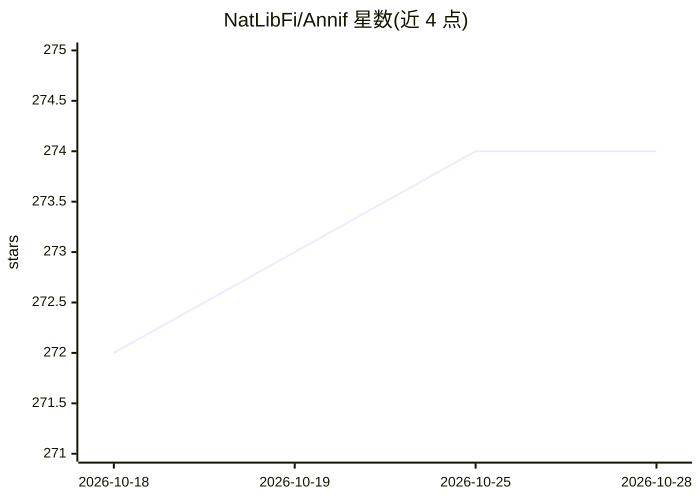

# NatLibFi/Annif

⭐ 274 · Python · NOASSERTION · 推送 2026-10-28 · [GitHub](https://github.com/NatLibFi/Annif) · [官网](https://annif.org) · 组织维护

**面向图书馆等机构的自动主题标引工具包**

由芬兰国家图书馆维护的多算法自动主题标引（subject indexing）工具包，最初以 Finna.fi 发现界面的元数据作为训练语料构建。提供管理用 CLI 命令，以及面向终端用户的 REST API 和 Web UI；支持 bash/zsh/fish 的 Tab 补全。后端含 fastText、Omikuji 等可选组件及 Voikko、spaCy 分析器；支持可选的 PyTorch 后端（CPU/CUDA 12.6/CUDA 13.0 extras）。开发测试在 Linux 上进行，Windows/macOS 官方推荐通过 Docker 或 Linux 虚拟机运行，需 Python 3.11-3.13。

## 筛选速览

| 维度 | 判定 | 备注 |
|---|---|---|
| AI 角色 | `ai-native` | 本体是模型或模型工具 |
| 许可风险 | `none` | NOASSERTION |
| 部署形态 | `library` | 以包/库形式分发 |
| 模型依赖 | — | README 未给出锁定关系 |
| 硬件要求 | — | 无带数字的原话,不猜 |
| 安装摩擦 | `low` | 无编译、无系统依赖或容器化 |
| 成熟度 | — | 结构信号不足 |

## 能力要点

- 多算法自动主题标引，含 fastText、Omikuji 等可选后端
- 提供 CLI 管理命令、REST API 与 Web UI
- PyPI 安装、Docker 镜像与 GitHub Codespaces 演示环境
- 可选 PyTorch 后端，支持 CPU / CUDA 12.6 / CUDA 13.0

## 适用场景

- 图书馆、档案馆、博物馆为馆藏元数据自动生成主题词
- 批量文献分类标引并集成到现有编目流程
- 通过 REST API 为终端用户提供主题建议服务

## 场景标签

 · 领域:图书馆与信息科学/文本分类

## 证据(README 行号)

> L14: Annif is an automated subject indexing toolkit. It was originally created as
> L18: Annif provides CLI commands for administration, and a REST API and web UI for end-users.
> L132: Annif at the GermEval-2025 LLMs4Subjects Task: Traditional XMTC Augmented by Efficient LLMs, pre-print.

## 星数曲线

2026-10-18 272 → 2026-10-28 274（+2）

---
*卡片 v1 · prompt 1.4 · 生成 2026-10-22 · 置信度 high · 依据 README sha `5efef1f4573b` · [字段定义](../../DATASET.md)*
