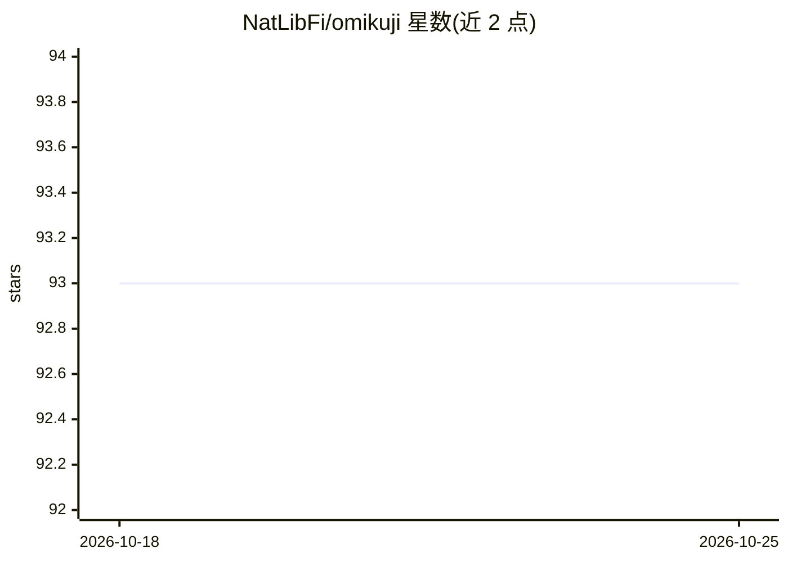

# NatLibFi/omikuji

⭐ 93 · Rust · MIT · 推送 2026-10-12 · [GitHub](https://github.com/NatLibFi/omikuji) · [官网](https://crates.io/crates/omikuji) · 组织维护

**极端多标签分类算法库：Rust 实现分区标签树及变体**

用 Rust 编写的 Partitioned Label Trees（Parabel）及多种变体的高效实现，面向极端多标签分类（标签数量极大的数据集）。支持更并行的 Parabel 训练、Bonsai 式常规 k-means 浅树、HOMER 平衡 k-means 以及 AttentionXML 式的层折叠技术；在 Extreme Classification Repository 数据集上给出了精度与训练时间数据。自 2026 年 8 月起由芬兰国家图书馆维护，供 Annif 等工具使用。提供 Cargo 安装的 CLI 和 pip 安装的 Python 绑定，数据格式为头部三整数加每行标签与特征值对。

## 筛选速览

| 维度 | 判定 | 备注 |
|---|---|---|
| AI 角色 | `ai-native` | 本体是模型或模型工具 |
| 许可风险 | `permissive` | MIT |
| 部署形态 | `library` | 以包/库形式分发 |
| 模型依赖 | — | README 未给出锁定关系 |
| 硬件要求 | — | 无带数字的原话,不猜 |
| 安装摩擦 | `low` | 无编译、无系统依赖或容器化 |
| 成熟度 | — | 结构信号不足 |

## 能力要点

- Parabel 的并行化实现，四核机器上训练提速 1.3x–1.7x
- 支持常规 k-means、平衡 k-means、层折叠等多种树构建变体
- Cargo CLI 与 pip Python 绑定两种使用方式
- 由芬兰国家图书馆维护，配合 Annif 等工具使用

## 适用场景

- 在数十万级标签的数据集上做多标签分类训练与预测
- 为 Annif 等自动标引工具提供分类后端
- 复现 EURLex-4K、Amazon-670K 等基准数据集的结果

## 场景标签

 · 领域:机器学习/文本分类

## 证据(README 行号)

> L5: An efficient implementation of Partitioned Label Trees (Prabhu et al., 2018) and its variations for extreme multi-la
> L104: omikuji train eurlex_train.txt --model_path ./model

## 星数曲线

2026-10-18 93 → 2026-10-25 93（+0）

---
*卡片 v1 · prompt 1.4 · 生成 2026-10-23 · 置信度 high · 依据 README sha `320fbe066656` · [字段定义](../../DATASET.md)*
