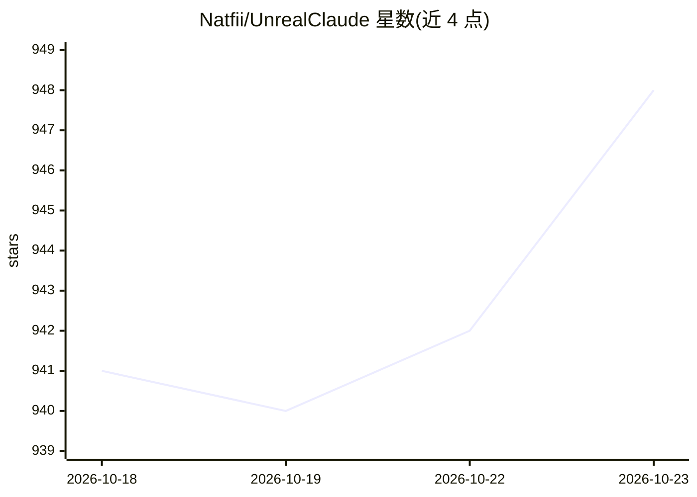

# Natfii/UnrealClaude

⭐ 948 · C++ · 推送 2026-06-26 · [GitHub](https://github.com/Natfii/UnrealClaude) · 个人维护

**UE5.7 编辑器内集成 Claude Code CLI 的 AI 编码助手插件**

Unreal Engine 5.7 编辑器插件，将 Claude Code CLI 集成为停靠聊天面板（流式输出、工具调用分组、会话持久化），复用 Claude Code 登录凭据，无需单独 API key。内置 MCP 服务器（20+ 工具）暴露 Actor、Blueprint、关卡、资产、材质、输入等编辑器操作，并带按需加载 UE5.7 API 文档的动态上下文系统；脚本执行默认隐藏且经权限对话框把关。支持 Windows/Linux/macOS(Apple Silicon)，须从源码构建，无预编译包。

## 筛选速览

| 维度 | 判定 | 备注 |
|---|---|---|
| AI 角色 | `ai-ecosystem` | LLM/agent 周边工具 |
| 许可风险 | `none` | — |
| 部署形态 | `library` | 以包/库形式分发 |
| 模型依赖 | locked-api |  |
| 硬件要求 | — | 无带数字的原话,不猜 |
| 安装摩擦 | `low` | 无编译、无系统依赖或容器化 |
| 成熟度 | — | 结构信号不足 |

## 能力要点

- 编辑器内聊天面板集成 Claude Code CLI，复用其认证
- MCP 服务器提供 20+ 工具（Actor/Blueprint/关卡/资产/材质/输入等）
- 动态 UE5.7 API 文档上下文加载系统
- 脚本写入/编译(Live Coding)/执行均经 deny-by-default 权限对话框

## 适用场景

- 在 UE 编辑器内直接与 Claude 对话获得带 UE5.7 文档上下文的编码帮助
- 让 Claude 通过 MCP 工具操作 Actor、Blueprint 与关卡
- 用自然语言查询项目模块、插件与资产结构

## 场景标签

`编码 Agent` · 领域:编码与开发

## 证据(README 行号)

> L10: **Claude Code CLI integration for Unreal Engine 5.7** - Get AI coding assistance with built-in UE5.7 documentation 
> L15: UnrealClaude integrates the Claude Code CLI directly into the Unreal Engine 5.7 Editor and runs a MCP server for ac
> L22: - **MCP Server** - 20+ Model Context Protocol tools for actor manipulation, Blueprint editing, level management, ma

## 星数曲线

2026-10-18 941 → 2026-10-23 948（+7）

---
*卡片 v1 · prompt 1.4 · 生成 2026-10-21 · 置信度 high · 依据 README sha `56058a3d70df` · [字段定义](../../DATASET.md)*
