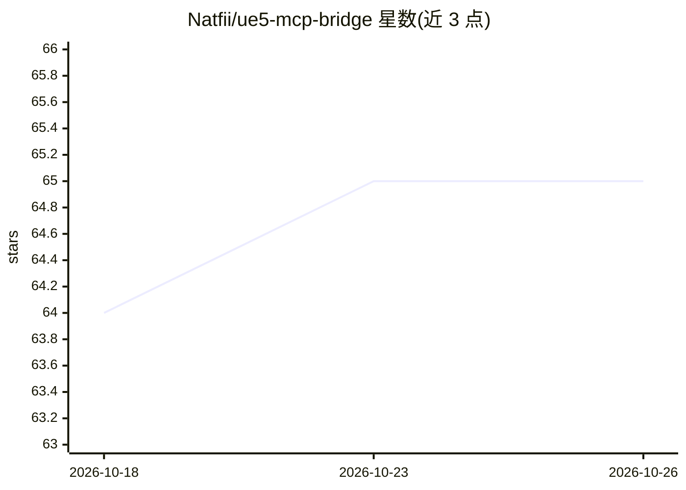

# Natfii/ue5-mcp-bridge

⭐ 65 · JavaScript · NOASSERTION · 推送 2026-06-26 · [GitHub](https://github.com/Natfii/ue5-mcp-bridge) · 个人维护

**连接 AI 助手与 UE5 编辑器的 MCP 服务器**

基于 Model Context Protocol 的服务器，通过 stdio 传输与 HTTP 端点（默认配合 UnrealClaude 插件）桥接 MCP 兼容 AI 客户端与 Unreal Engine 5 编辑器。提供关卡/Actor 操作、Blueprint 与 Animation Blueprint 修改、资产搜索、脚本执行、Enhanced Input、异步任务队列等工具集，并内置 UE 5.7 API 文档查询与自动上下文注入。README 明确声明这不是“文字生成游戏”工具，不生成 3D 模型/贴图/动画，定位为工作流加速器。需 Node.js 18+，git clone 源码安装。

## 筛选速览

| 维度 | 判定 | 备注 |
|---|---|---|
| AI 角色 | `ai-ecosystem` | LLM/agent 周边工具 |
| 许可风险 | `permissive` | NOASSERTION |
| 部署形态 | `library` | 以包/库形式分发 |
| 模型依赖 | locked-api |  |
| 硬件要求 | — | 无带数字的原话,不猜 |
| 安装摩擦 | `low` | 无编译、无系统依赖或容器化 |
| 成熟度 | — | 结构信号不足 |

## 能力要点

- 覆盖关卡/Actor、Blueprint、Animation Blueprint、材质、Enhanced Input 等约 30 个 MCP 工具
- Animation Blueprint 完整操作：状态机、过渡、条件图节点、批量原子操作
- 内置 UE 5.7 API 文档查询与自动上下文注入（INJECT_CONTEXT）
- 异步任务队列：提交/查询/取消后台执行的 MCP 工具调用
- 包含 87 个 Vitest 测试，可脱离 Unreal Editor 运行

## 适用场景

- 在 Claude/Cursor 等 MCP 客户端中用自然语言操作 UE5 编辑器
- 快速搭建 Blueprint、状态机、输入绑定等项目脚手架
- 开发过程中查询 UE5 API 文档并捕获视口截图

## 场景标签

`编码 Agent` · 领域:编码与开发

## 证据(README 行号)

> L5: An MCP (Model Context Protocol) server that bridges AI assistants to Unreal Engine 5's editor, enabling direct manip
> L17: This server uses the standard Model Context Protocol and works with **any MCP-compatible AI client**, including:

## 星数曲线

2026-10-18 64 → 2026-10-26 65（+1）

---
*卡片 v1 · prompt 1.4 · 生成 2026-10-24 · 置信度 high · 依据 README sha `359ae3b97b4c` · [字段定义](../../DATASET.md)*
