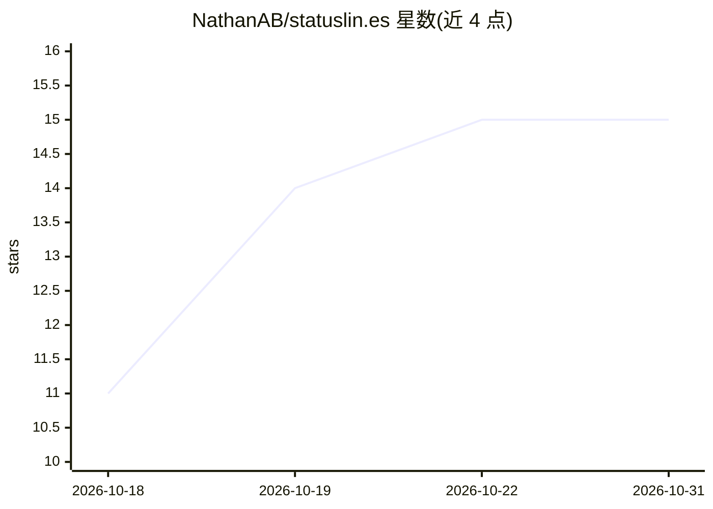

# NathanAB/statuslin.es

⭐ 15 · TypeScript · MIT · 推送 2026-10-29 · [GitHub](https://github.com/NathanAB/statuslin.es) · [官网](https://statuslin.es) · 个人维护

**Claude Code 状态栏配置社区画廊：展示真实渲染预览**

收录社区提交的 Claude Code status line 配置脚本，在页面以真实渲染预览呈现，用户可浏览被复制较多的配置并复制到终端。提交的脚本仅在提交时于无网络、5 秒超时的 E2B 沙箱中运行一次生成预览，浏览页面只服务预渲染 HTML；每个配置经人工审核后按内容哈希固定发布。技术栈为 Bun、TanStack Start、Drizzle + Postgres、Better Auth（GitHub 登录）；代码库声明 agent-first，多数变更由 AI agent 依机械门禁编写。

## 筛选速览

| 维度 | 判定 | 备注 |
|---|---|---|
| AI 角色 | `ai-knowledge` | 知识聚合/清单类 |
| 许可风险 | `permissive` | MIT |
| 部署形态 | `self-host` | docker 或自建部署 |
| 模型依赖 | — | README 未给出锁定关系 |
| 硬件要求 | — | 无带数字的原话,不猜 |
| 安装摩擦 | `low` | 无编译、无系统依赖或容器化 |
| 成熟度 | — | 结构信号不足 |

## 能力要点

- 提交脚本仅在 E2B 沙箱运行一次（默认无网络、5 秒超时）生成预览
- 每个配置经人工审核并按内容哈希不可变发布
- 声明 agent-first 代码库，多数变更由 AI agent 编写
- 本地开发基于 Bun + Docker Postgres 容器

## 适用场景

- 浏览并复制他人的 Claude Code 状态栏配置
- 提交自己的 status line 脚本并查看真实渲染效果
- 参考其沙箱化运行陌生脚本的安全模型

## 场景标签

 · 领域:开发者工具/配置画廊

## 证据(README 行号)

> L3: A community gallery of Claude Code status lines. Browse real configs as
> L11: A status line is an arbitrary script Claude Code runs to draw the bottom strip of your terminal, so this
> L28: This is an **agent-first** codebase: most changes are written by AI agents against mechanical gates

## 星数曲线

2026-10-18 11 → 2026-10-31 15（+4）

---
*卡片 v1 · prompt 1.4 · 生成 2026-10-30 · 置信度 mid · 依据 README sha `cdefcf4d03c1` · [字段定义](../../DATASET.md)*
