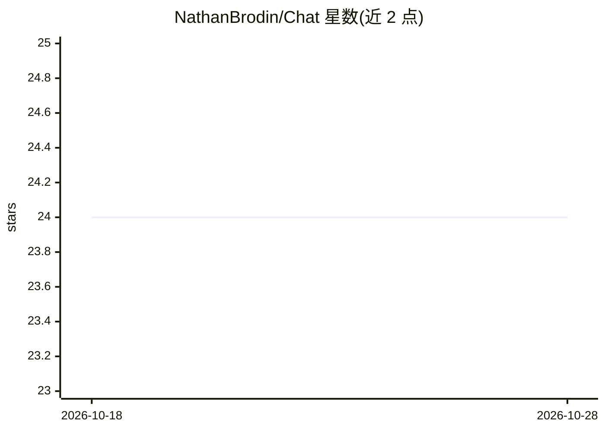

# NathanBrodin/Chat

⭐ 24 · TypeScript · MIT · 推送 2026-10-28 · [GitHub](https://github.com/NathanBrodin/Chat) · [官网](https://chat.brodin.dev) · 个人维护

**以 AI 对话形式呈现的个人作品集网站（交互式简历）**

基于 Next.js App Router、Tailwind CSS 与 Vercel AI SDK 构建的聊天机器人式个人作品集：访客通过提问了解作者的履历、技能、项目与经历，替代传统翻页浏览。默认接入 Anthropic API，可通过修改 streamText() 的模型切换到其他提供商；使用 Vercel Postgres（Neon）保存聊天记录、Upstash 做速率限制。支持一键部署到 Vercel，本地用 Bun 运行，内容放在 ./content 目录下可替换为使用者自己的经历。

## 筛选速览

| 维度 | 判定 | 备注 |
|---|---|---|
| AI 角色 | `ai-native` | 本体是模型或模型工具 |
| 许可风险 | `permissive` | MIT |
| 部署形态 | `library` | 以包/库形式分发 |
| 模型依赖 | — | README 未给出锁定关系 |
| 硬件要求 | — | 无带数字的原话,不猜 |
| 安装摩擦 | `low` | 无编译、无系统依赖或容器化 |
| 成熟度 | — | 结构信号不足 |

## 能力要点

- 聊天对话形式的交互式简历，默认接入 Anthropic API
- 支持切换 AI SDK 的其他模型提供商（OpenAI、Cohere 等）
- Vercel 一键部署，本地通过 Bun 安装与运行
- ./content 目录内容可替换为个人履历

## 适用场景

- 用对话方式向访客展示个人履历与项目
- 部署属于自己的 AI 聊天作品集站点
- 记录访客聊天记录用于后续调整回答内容

## 场景标签

`聊天机器人` · 领域:对话与助手

## 证据(README 行号)

> L6: It’s my portfolio, reimagined as a chat conversation, answered by AI.
> L13: Nathan's AI is a unique twist on the traditional portfolio. Instead of scrolling through pages of information, visi

## 星数曲线

2026-10-18 24 → 2026-10-28 24（+0）

---
*卡片 v1 · prompt 1.4 · 生成 2026-10-27 · 置信度 mid · 依据 README sha `bdcb93c4241c` · [字段定义](../../DATASET.md)*
