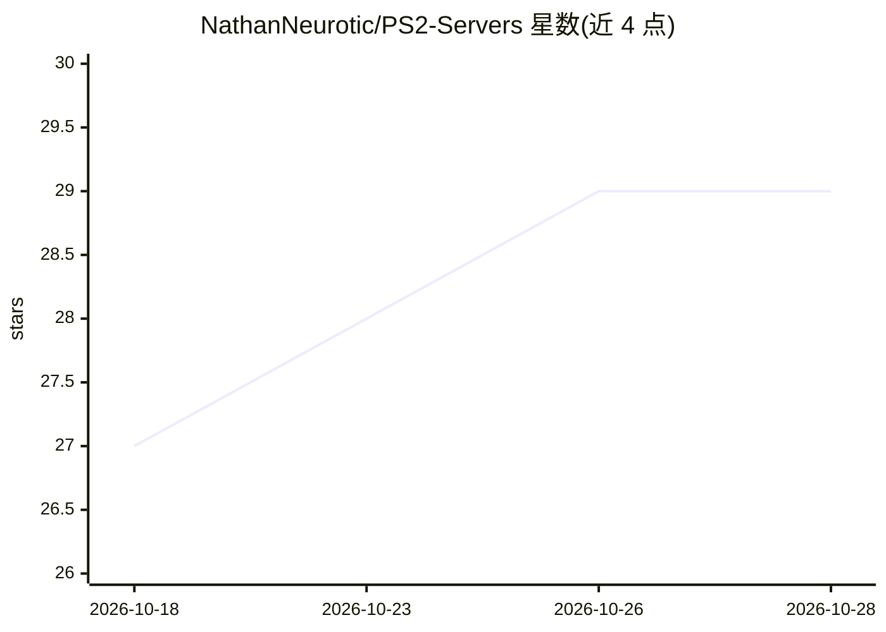

# NathanNeurotic/PS2-Servers

⭐ 29 · Python · AFL-3.0 · 推送 2026-10-27 · [GitHub](https://github.com/NathanNeurotic/PS2-Servers) · [官网](https://nathanneurotic.github.io/PS2-Servers/) · 个人维护

**为 PS2 自制软件提供 SMB/HTTP/UDPBD/UDPFS 局域网游戏服务器**

面向 PlayStation 2 自制软件（homebrew）用户的游戏与文件服务器套件：Desktop 版提供 Tkinter 图形启动器，Core 版以 Python 从终端运行同一套服务器，Edge 版为 Go 编写的独立服务器，面向路由器、NAS、树莓派与无头设备。支持 UDPFS、SMBv1、SMBv2/3、实验性 HTTP 游戏串流与 UDPBD 块设备服务，兼容 OPL、POPStarter、NHDDL、MODULO 等加载器。Desktop 附带 SQLite 游戏目录、封面转换与 RetroAchievements 相关功能；UDPBD 支持原始磁盘/分区暴露与 VMC 存档写入。README 标注其为 AI 辅助开发（AI-Assisted-Software-Development），产品本身不提供 AI 功能。

## 筛选速览

| 维度 | 判定 | 备注 |
|---|---|---|
| AI 角色 | `ai-enhanced` | 去掉 AI 部分产品仍成立 |
| 许可风险 | `viral` | AFL-3.0 |
| 部署形态 | `desktop` | 安装包/桌面程序 |
| 模型依赖 | — | README 未给出锁定关系 |
| 硬件要求 | — | 无带数字的原话,不猜 |
| 安装摩擦 | `low` | 无编译、无系统依赖或容器化 |
| 成熟度 | `idea` | |

## 能力要点

- Desktop（GUI）、Core（终端）、Edge（Go，路由器/NAS/树莓派）三种形态共享同一套服务器实现
- UDPFS/SMBv1/SMBv2-3/HTTP/UDPBD 五种协议服务，兼容 OPL、POPStarter、NHDDL 等加载器
- Desktop 含 SQLite 游戏目录、ISO/CSO/ZSO/CHD 导入与 8-bit PNG 封面转换
- UDPBD 原始磁盘/分区服务，支持独占访问与 VMC 存档写入（2 TiB 以上设备被拒）

## 适用场景

- 在局域网内通过 OPL/NHDDL 等加载器从 PC 玩 PS2 游戏
- 在路由器或树莓派上部署无头游戏服务器
- 用原始磁盘或虚拟 exFAT 文件夹通过 UDPBD 提供块设备

## 场景标签

 · 领域:游戏工具/复古主机网络服务

## 证据(README 行号)

> L2:  AI-Assisted-Software-Development
> L11: PS2 Servers runs game and file servers for network-capable PlayStation 2

## 星数曲线

2026-10-18 27 → 2026-10-28 29（+2）

---
*卡片 v1 · prompt 1.4 · 生成 2026-10-26 · 置信度 low · 依据 README sha `cab93223acad` · [字段定义](../../DATASET.md)*
