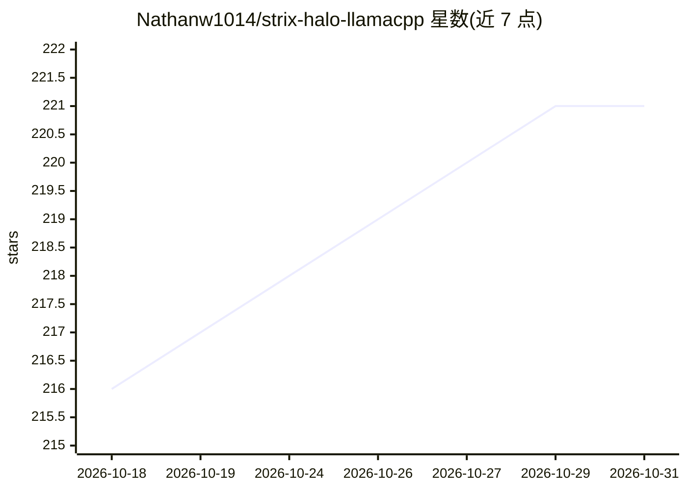

# Nathanw1014/strix-halo-llamacpp

⭐ 221 · Python · NOASSERTION · 推送 2026-10-25 · [GitHub](https://github.com/Nathanw1014/strix-halo-llamacpp) · 个人维护

**面向 AMD Strix Halo 的 llama.cpp 优化构建：FA 与 MoE-prefill 修复**

llama.cpp 的下游分叉，为 AMD Strix Halo（Ryzen AI Max+ 395 / gfx1151）调优，面向长上下文、量化 KV 工作负载。捆绑一组 Flash-Attention 与 MoE-prefill 修复（FA 内核一次性反量化、f16 KV 连续化、wave32 重排、MoE row-list 预处理等），并自带 Mesa RADV 驱动。Vulkan 后端为推荐默认，HIP/ROCm 后端仅提供 Dockerfile 需自行构建。分发方式为便携 tarball、ghcr 容器镜像或从 strix-halo-vulkan 分支源码构建。README 附带逐项修复的性能归因与基准数据。

## 筛选速览

| 维度 | 判定 | 备注 |
|---|---|---|
| AI 角色 | `ai-ecosystem` | LLM/agent 周边工具 |
| 许可风险 | `none` | NOASSERTION |
| 部署形态 | `self-host` | docker 或自建部署 |
| 模型依赖 | local-ok | 支持本地模型 |
| 硬件要求 | — | 无带数字的原话,不猜 |
| 安装摩擦 | `low` | 无编译、无系统依赖或容器化 |
| 成熟度 | — | 结构信号不足 |

## 能力要点

- FA dequant-once 等修复使量化 KV 深层 prefill 提速（Coder-30B @64k 达 3.26x）
- 自带 Mesa 26.3.0-devel RADV 驱动，便携 tarball 无需宿主 Mesa 与构建
- 提供 Vulkan（默认）与 HIP/ROCm 两种后端，HIP 需自行构建容器镜像
- 基准数据含逐项修复归因与可复现的原始数据路径

## 适用场景

- 在 Strix Halo 整机上跑长上下文、量化 KV 的本地 LLM 推理
- 在不装 ROCm 的主机上用捆绑 RADV 驱动直接运行 llama-server
- 对比 Vulkan 与 HIP 后端在该硬件上的 prefill/decode 性能

## 场景标签

`推理引擎` · 领域:训练与推理

## 证据(README 行号)

> L3: A ready-to-run llama.cpp for AMD Strix Halo (Ryzen AI Max+ 395 / Radeon 8060S / gfx1151),
> L93: - **`vulkan/`** self-contained Vulkan/RADV build (recommended default backend on this hardware).

## 星数曲线

2026-10-18 216 → 2026-10-31 221（+5）

---
*卡片 v1 · prompt 1.4 · 生成 2026-10-22 · 置信度 high · 依据 README sha `b5f8d124b95a` · [字段定义](../../DATASET.md)*
