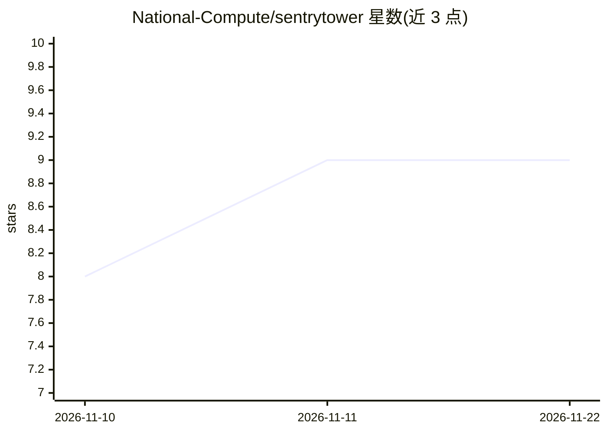

# National-Compute/sentrytower

⭐ 9 · Python · Apache-2.0 · 推送 2026-11-19 · [GitHub](https://github.com/National-Compute/sentrytower) · 组织维护

**用多智能体审计代码仓库并输出漏洞报告的安全工具**

SentryTower 以攻击者视角读取仓库，对代码单元做安全信号排序后由 agent 群逐项检查，对最强线索进入深度 agent 会话，再由第二次模型调用独立裁决每条发现。输出含文件、行号、CWE 与证据的 HTML/JSON/SARIF/Markdown 报告，通过本地网关强制执行美元成本上限与 token 上限，默认上限 $2。每次审计最多 6 条发现、每文件 2 条；超 1000 文件的仓库改用单个深度 agent。支持 OpenRouter、任意 OpenAI 兼容端点或本地模型服务器。

## 筛选速览

| 维度 | 判定 | 备注 |
|---|---|---|
| AI 角色 | `ai-native` | 本体是模型或模型工具 |
| 许可风险 | `permissive` | Apache-2.0 |
| 部署形态 | `self-host` | docker 或自建部署 |
| 模型依赖 | local-ok | 支持本地模型 |
| 硬件要求 | — | 无带数字的原话,不猜 |
| 安装摩擦 | `low` | 无编译、无系统依赖或容器化 |
| 成熟度 | `idea` | |

## 能力要点

- 多 agent 群审计 + 独立第二模型裁决发现
- 本地网关强制成本上限（默认 $2）与 token 上限
- 输出 SARIF 2.1.0、JSON、Markdown、HTML 并提供 GitHub Action 上传
- agent 仅持四个只读工具，不运行仓库内程序

## 适用场景

- 在 CI 中对仓库做安全审计并以退出码作为发布门禁
- 将扫描结果以 SARIF 上传到 GitHub code scanning
- 用本地模型服务器离线审计私有代码
- 按预算深度（quick/standard/deep/max）控制审计开销

## 场景标签

`多智能体` `代码审查` · 领域:Agent 开发

## 证据(README 行号)

> L3:  Audit your code with a swarm of AI agents.
> L4:  SentryTower reads your repository the way an attacker would and reports each vulnerability
> L40: An inventory maps every code unit and its security signals. The swarm
> L226: 4. **The gateway.** Every model call goes through a local gateway. It holds

## 星数曲线

2026-11-10 8 → 2026-11-22 9（+1）

---
*卡片 v1 · prompt 1.4 · 生成 2026-11-20 · 置信度 mid · 依据 README sha `f073a78aa924` · [字段定义](../../DATASET.md)*
