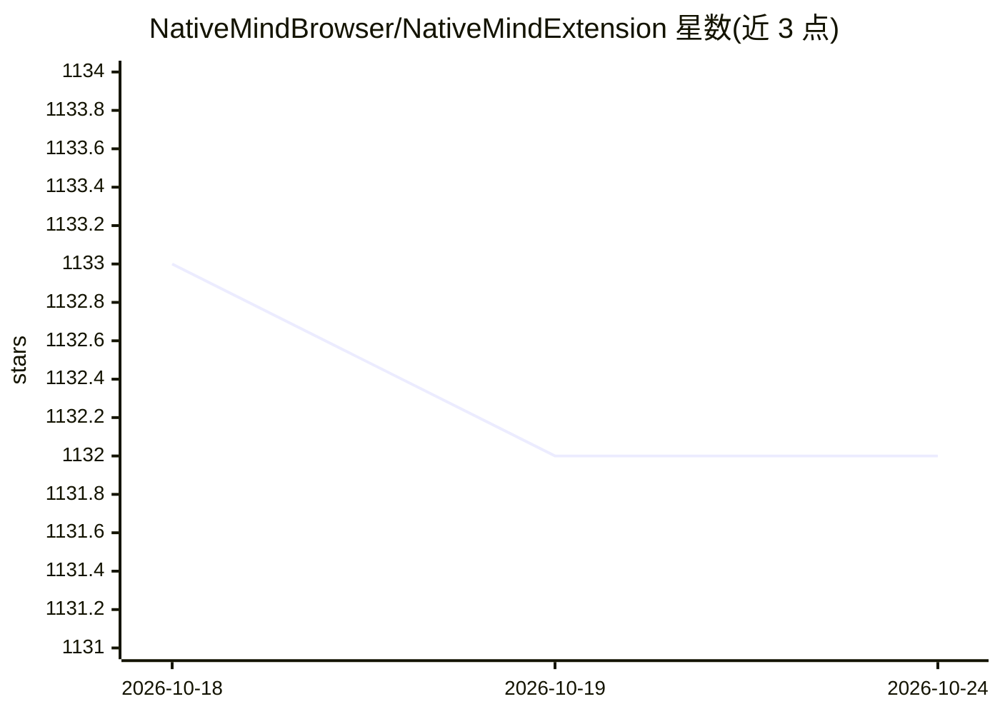

# NativeMindBrowser/NativeMindExtension

⭐ 1,132 · TypeScript · AGPL-3.0 · 推送 2026-03-23 · [GitHub](https://github.com/NativeMindBrowser/NativeMindExtension) · [官网](https://nativemind.app) · 组织维护

**在浏览器本地运行 LLM 的隐私优先 AI 助手扩展**

面向终端用户的浏览器扩展（支持 Chrome/Firefox/Brave/Edge），将本地大模型引入浏览工作流：AI Agent 自主任务执行、网页总结与翻译、PDF/图像对话、写作辅助与本地搜索，全部处理在设备端完成、无需账号。模型后端两种：推荐配合本地运行的 Ollama（支持 Deepseek、Qwen、Llama、gpt-oss 等），或零安装的 WebLLM（浏览器内 WebAssembly 运行 Qwen3-0.6B 试用）。以应用商店安装为主，开发者可从源码构建（Vue 3 + WXT + PNPM），AGPL v3 许可。

## 筛选速览

| 维度 | 判定 | 备注 |
|---|---|---|
| AI 角色 | `ai-native` | 本体是模型或模型工具 |
| 许可风险 | `viral` | AGPL-3.0 |
| 部署形态 | `library` | 以包/库形式分发 |
| 模型依赖 | local-ok | 支持本地模型 |
| 硬件要求 | — | 无带数字的原话,不猜 |
| 安装摩擦 | `low` | 无编译、无系统依赖或容器化 |
| 成熟度 | — | 结构信号不足 |

## 能力要点

- AI Agent 多步任务执行与工具集成，全程本地处理
- 双后端：Ollama 本地服务 + WebLLM 浏览器内 WebAssembly 运行
- 网页总结、双语对照翻译、PDF/图像对话、自定义 Quick Actions
- 下载模型后完全离线可用，无需注册账号

## 适用场景

- 在浏览网页时直接调用本地 AI 总结、翻译和问答，不把数据发给云端
- 配合 Ollama 在本机跑 Deepseek/Qwen 等模型做日常 AI 助手
- 不想安装本地服务时用 WebLLM 在浏览器内先试用 AI 能力

## 场景标签

`AI 助手` `文档问答` `浏览器自动化` · 领域:效率与自动化

## 证据(README 行号)

> L6: *NativeMind is a private, open-source alternative to ChatGPT — a fully local browser extension built on Ollama that 
> L36: ### 🤖 **AI Agent - Your Intelligent Assistant**
> L93: ### 🦙 **Ollama (Recommended)**

## 星数曲线

2026-10-18 1,133 → 2026-10-24 1,132（-1）

---
*卡片 v1 · prompt 1.4 · 生成 2026-10-21 · 置信度 mid · 依据 README sha `0e2a7302b3b3` · [字段定义](../../DATASET.md)*
