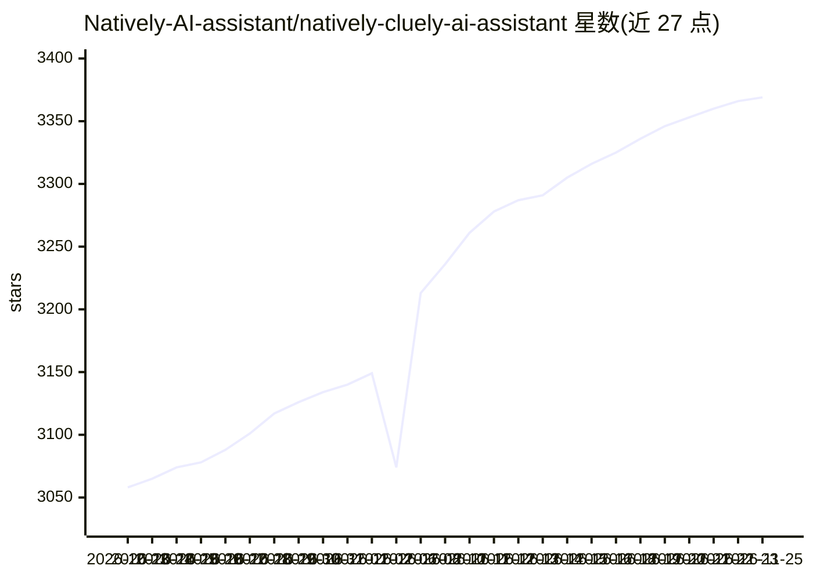

# Natively-AI-assistant/natively-cluely-ai-assistant

⭐ 3,369 · TypeScript · NOASSERTION · 推送 2026-11-22 · [GitHub](https://github.com/Natively-AI-assistant/natively-cluely-ai-assistant) · [官网](https://natively.software) · 组织维护

**开源 AI 会议助手与面试辅助工具，本地运行实时转录与作答**

面向会议与面试场景的桌面应用（macOS 12+/Windows 10/11），提供实时转录、屏幕截图分析、自动生成回答、会议笔记与仪表盘。转录由本地 ONNX 模型（Moonshine/Whisper/Parakeet）或 Apple Speech 在设备端完成；LLM 接入支持内置计划、自带 API key 或本地 Ollama 离线运行；本地 RAG 用 SQLite 向量搜索检索历史会议。个人/教育/非商业用途免费，商业使用需付费计划；安装提供 Homebrew cask。

## 筛选速览

| 维度 | 判定 | 备注 |
|---|---|---|
| AI 角色 | `ai-native` | 本体是模型或模型工具 |
| 许可风险 | `none` | NOASSERTION |
| 部署形态 | `desktop` | 安装包/桌面程序 |
| 模型依赖 | local-ok | 支持本地模型 |
| 硬件要求 | — | 无带数字的原话,不猜 |
| 安装摩擦 | `medium` | 含编译或系统依赖之一 |
| 成熟度 | — | 结构信号不足 |

## 能力要点

- 本地 Whisper/Moonshine/Parakeet STT，支持 CoreML/Metal/DirectML 加速
- 本地 Ollama 模型可 100% 离线运行，BYOK 支持
- SQLite 向量搜索的本地 RAG 会议记忆
- 9 种内置 persona 模式与隐藏于屏幕共享的 stealth 模式

## 适用场景

- 面试/会议中获得实时转录与作答建议
- 课程与研讨会录音并生成笔记
- 本地保存会议记录并按历史内容提问
- 需要离线、数据不出设备的会议助手场景

## 场景标签

`AI 助手` `RAG` `语音识别` · 领域:对话与助手

## 证据(README 行号)

> L3: # Natively — AI Interview Copilot & Meeting Assistant
> L103: - **Local Whisper STT (On-Device):** 100% on-device speech-to-text using optimized ONNX models (Moonshine-tiny, Mo
> L122: - **Fully Offline, If You Want It:** Rather nothing left your machine? Run Natively 100% offline with local Ollama

## 星数曲线

2026-10-23 3,058 → 2026-11-25 3,369（+311）

---
*卡片 v1 · prompt 1.4 · 生成 2026-11-23 · 置信度 mid · 依据 README sha `9fc9233d621f` · [字段定义](../../DATASET.md)*
