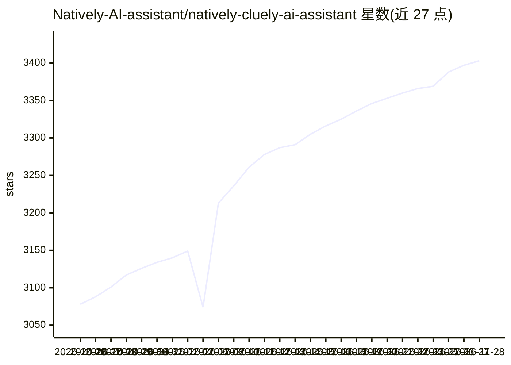

# Natively-AI-assistant/natively-cluely-ai-assistant

⭐ 3,403 · TypeScript · NOASSERTION · 推送 2026-11-27 · [GitHub](https://github.com/Natively-AI-assistant/natively-cluely-ai-assistant) · [官网](https://natively.software) · 组织维护

**本地运行的 AI 会议助手与面试 copilot，Cluely 的开源替代**

面向求职者与会议参与者的桌面 AI 助手：实时转录会议/面试音频，生成实时回答、会议笔记，并支持截图分析与本地 RAG 记忆查询。采用 Rust 音频采集，语音识别在本机运行（Moonshine、Whisper、Parakeet 等模型，ONNX 格式），LLM 可用自带计划、自有 API key 或本地模型（Ollama）。提供隐藏于屏幕共享的 stealth 模式、9 种内置场景 persona、Chrome 浏览器伴侣与笔记导出连接器。macOS 用 Homebrew 安装，Windows 提供安装包；个人/非商业用途免费，商业用途需付费计划。

## 筛选速览

| 维度 | 判定 | 备注 |
|---|---|---|
| AI 角色 | `ai-native` | 本体是模型或模型工具 |
| 许可风险 | `none` | NOASSERTION |
| 部署形态 | `desktop` | 安装包/桌面程序 |
| 模型依赖 | local-ok | 支持本地模型 |
| 硬件要求 | — | 无带数字的原话,不猜 |
| 安装摩擦 | `medium` | 含编译或系统依赖之一 |
| 成熟度 | — | 结构信号不足 |

## 能力要点

- 本机语音识别：Moonshine/Whisper/Parakeet 模型，CoreML/Metal/DirectML 加速
- 本地 RAG 记忆：SQLite 向量检索历史会议内容
- 支持自有 API key 与本地 Ollama 模型，可完全离线运行
- 9 种内置场景 persona（技术面试、销售、讲座等）

## 适用场景

- 面试时获取实时提示与系统设计图示
- 会议中自动生成回答、笔记与待办清单
- 离线环境下转录并查询历史会议内容

## 场景标签

`AI 助手` `RAG` `语音识别` · 领域:对话与助手

## 证据(README 行号)

> L3: # Natively — AI Interview Copilot & Meeting Assistant
> L103: - **Local Whisper STT (On-Device):** 100% on-device speech-to-text using optimized ONNX models (Moonshine-tiny, Mo
> L122: - **Fully Offline, If You Want It:** Rather nothing left your machine? Run Natively 100% offline with local Ollama

## 星数曲线

2026-10-26 3,078 → 2026-11-28 3,403（+325）

---
*卡片 v1 · prompt 1.4 · 生成 2026-11-27 · 置信度 mid · 依据 README sha `32b0a3201fb7` · [字段定义](../../DATASET.md)*
