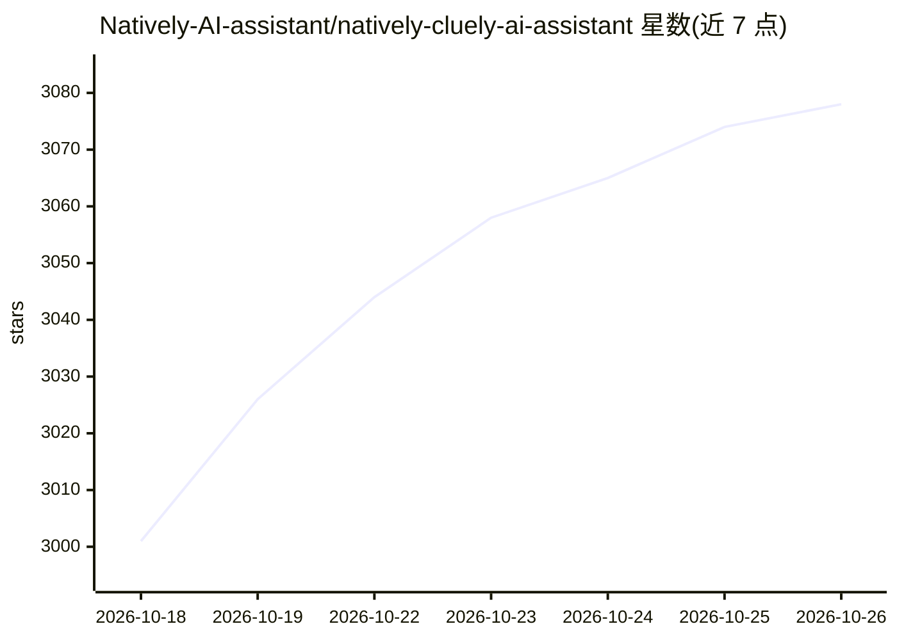

# Natively-AI-assistant/natively-cluely-ai-assistant

⭐ 3,078 · TypeScript · NOASSERTION · 推送 2026-10-25 · [GitHub](https://github.com/Natively-AI-assistant/natively-cluely-ai-assistant) · [官网](https://natively.software) · 组织维护

**面向面试与会议的桌面 AI 副驾：实时转录、隐形答案与本地 RAG**

在 macOS/Windows 上本地运行的面试助手与会议记录工具：Rust 原生音频采集（<500ms）、本地 Whisper/ONNX 语音转文字（支持 Moonshine、Parakeet 等模型与 CoreML/DirectML 加速）、双通道（系统音频/麦克风）转录管线。功能含隐形模式（对屏幕共享、Dock、任务栏、进程列表隐藏）、Auto Answer、Visual Answers 系统设计图、9 种模式角色、Chrome 伴生插件、SQLite 向量检索的本地 RAG 记忆与 BYOK 任意模型（可经 Ollama 全离线）。个人/非商业用途免费、源码可见。限制：隐形为 best-effort，不针对专业监考软件。

## 筛选速览

| 维度 | 判定 | 备注 |
|---|---|---|
| AI 角色 | `ai-native` | 本体是模型或模型工具 |
| 许可风险 | `none` | NOASSERTION |
| 部署形态 | `desktop` | 安装包/桌面程序 |
| 模型依赖 | local-ok | 支持本地模型 |
| 硬件要求 | — | 无带数字的原话,不猜 |
| 安装摩擦 | `low` | 无编译、无系统依赖或容器化 |
| 成熟度 | `idea` | |

## 能力要点

- 本地 Whisper STT（ONNX，Moonshine/Parakeet 多模型，CoreML/DirectML/int8 加速）
- 隐形模式：对屏幕共享、Dock、任务栏、进程列表隐藏，进程名伪装
- 本地 RAG 记忆（SQLite 向量检索）+ PDF/DOCX/TXT 参考文件注入实时上下文
- BYOK 任意 LLM，可经本地 Ollama 100% 离线运行

## 适用场景

- 技术面试中获取实时转录、答案生成与系统设计图辅助
- 会议/讲座记录并事后通过本地 RAG 检索历史内容
- 在不信任云端的前提下用本地模型全离线完成语音转写与问答

## 场景标签

`AI 助手` `语音识别` `文档问答` · 领域:对话与助手

## 证据(README 行号)

> L95: - **Native Audio Capture (<500ms):** Built with Rust and Zero-Copy ABI transfers, bypassing generic web-audio limit
> L96: - **Local Whisper STT (On-Device):** 100% on-device speech-to-text using optimized ONNX models (Moonshine-tiny, Moo
> L111: - **Fully Offline Capable:** Don't trust the cloud? Run Natively 100% offline using local Ollama models and local 

## 星数曲线

2026-10-18 3,001 → 2026-10-26 3,078（+77）

---
*卡片 v1 · prompt 1.4 · 生成 2026-10-20 · 置信度 mid · 依据 README sha `1b3c8014a5e3` · [字段定义](../../DATASET.md)*
