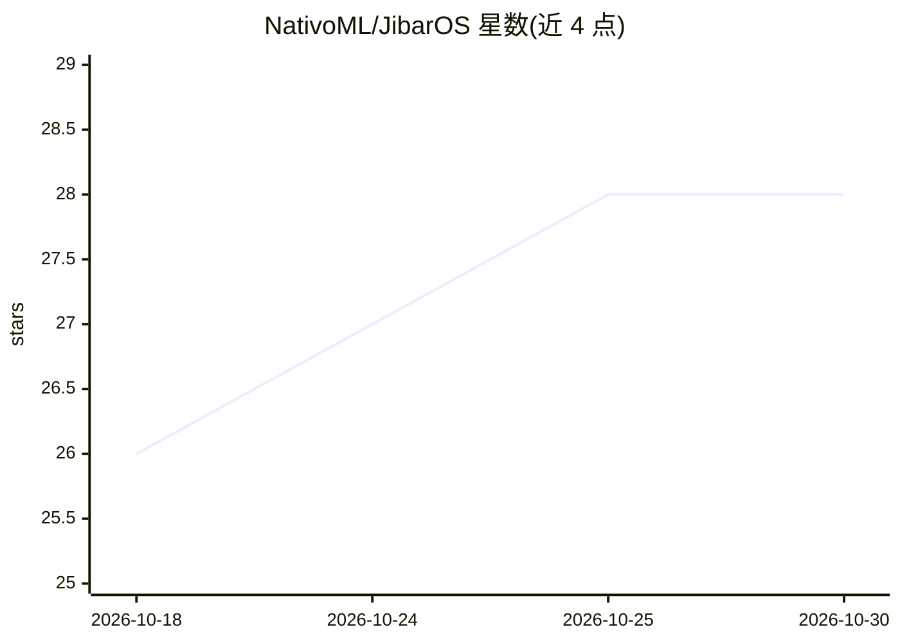

# NativoML/JibarOS

⭐ 28 · Shell · Apache-2.0 · 推送 2026-05-06 · [GitHub](https://github.com/NativoML/JibarOS) · [官网](https://github.com/Jibar-OS/JibarOS) · 组织维护

**Android 16 fork：把 12 项端侧 AI 能力做成平台级共享运行时**

基于 Android 16（AOSP）的操作系统 fork，将文本补全、翻译、嵌入、转写、语音活动检测、图像描述/检测/OCR 等 12 项 AI 能力通过单一 binder AIDL 系统服务暴露给所有应用。模型在平台层加载一次、跨应用共享，带上下文池、内存预算与 LRU 淘汰、优先级队列；支持 llama.cpp / whisper.cpp / ONNX Runtime / libmtmd 四个可插拔后端，OEM 可按能力配置模型（GGUF/ONNX）。面向 OEM、设备厂商与 Android 平台开发者；自述 pre-1.0，需完整 AOSP 源码构建（repo sync + m 编译），参考构建在 Cuttlefish 上验证。

## 筛选速览

| 维度 | 判定 | 备注 |
|---|---|---|
| AI 角色 | `ai-ecosystem` | LLM/agent 周边工具 |
| 许可风险 | `permissive` | Apache-2.0 |
| 部署形态 | `None` |  |
| 模型依赖 | local-ok | 支持本地模型 |
| 硬件要求 | — | 无带数字的原话,不猜 |
| 安装摩擦 | `low` | 无编译、无系统依赖或容器化 |
| 成熟度 | `idea` | |

## 能力要点

- 12 项能力经单一 binder AIDL 暴露给任意应用，模型平台层加载一次跨应用共享
- 四个可插拔后端：llama.cpp / whisper.cpp / ONNX Runtime / libmtmd
- OEM 按 capability 配置模型（GGUF/ONNX），更换模型无需改应用或框架
- 共享驻留、KV 缓存预算、LRU 淘汰与优先级感知调度

## 适用场景

- OEM 在离网/隐私敏感设备上预置端侧 AI 能力
- 应用通过 oir-sdk 调用平台级补全/转写/检测而无需自带模型
- 多应用共享模型以降低重复内存占用

## 场景标签

`语音识别` `多模态` `OCR` `推理引擎` · 领域:感知与多模态

## 证据(README 行号)

> L20: Twelve AI capabilities — text completion, translation, embeddings, classification, rerank, transcription, synthesis
> L22: This is runtime infrastructure, not a chatbot. The closest mental model is **"a kernel for on-device inference"** —

## 星数曲线

2026-10-18 26 → 2026-10-30 28（+2）

---
*卡片 v1 · prompt 1.4 · 生成 2026-10-26 · 置信度 high · 依据 README sha `7d166987ae40` · [字段定义](../../DATASET.md)*
