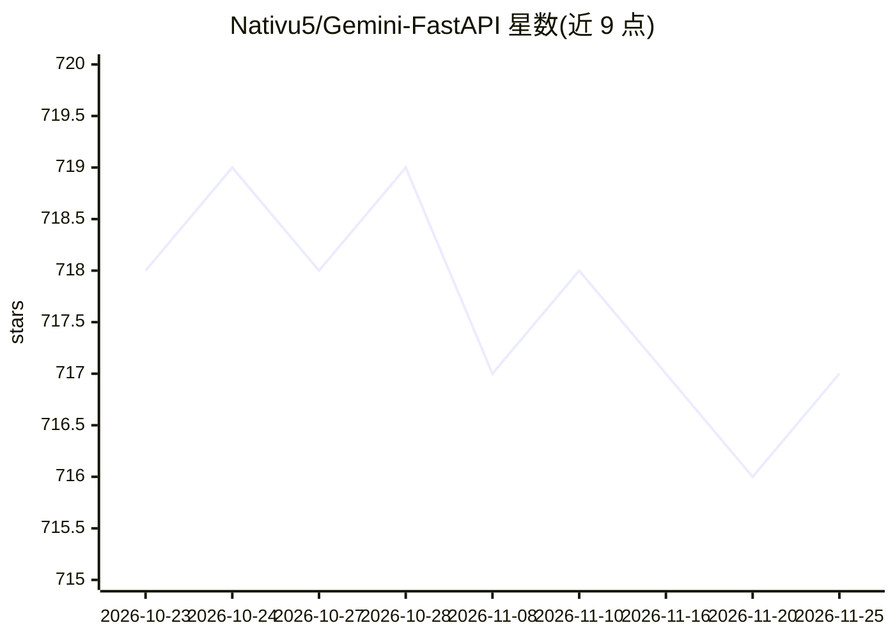

# Nativu5/Gemini-FastAPI

⭐ 717 · Python · MIT · 推送 2026-11-23 · [GitHub](https://github.com/Nativu5/Gemini-FastAPI) · 个人维护

**将 Gemini 网页版封装为 OpenAI 兼容 API 的自托管网关**

基于 FastAPI 的服务，用已登录 Gemini 网页会话的 Cookie 鉴权（无需 Google API Key），把网页版模型暴露为三类接口：OpenAI Chat Completions、OpenAI Responses 与 Gemini 原生 generateContent。支持流式、工具调用、结构化输出、图像/文件输入与图像生成、多账号请求分摊与独立代理。限制：temperature、top_p 等参数被接受但无效；结构化输出靠提示词请求并由服务端校验；依赖 Python 3.13+ 与 uv，或以 Docker 运行。

## 筛选速览

| 维度 | 判定 | 备注 |
|---|---|---|
| AI 角色 | `ai-ecosystem` | LLM/agent 周边工具 |
| 许可风险 | `permissive` | MIT |
| 部署形态 | `self-host` | docker 或自建部署 |
| 模型依赖 | — | README 未给出锁定关系 |
| 硬件要求 | — | 无带数字的原话,不猜 |
| 安装摩擦 | `low` | 无编译、无系统依赖或容器化 |
| 成熟度 | — | 结构信号不足 |

## 能力要点

- 三种 API 接口均支持流式、工具调用与结构化输出
- 多账号分摊请求，每账号可配独立代理与浏览器指纹
- 三种聊天模式（normal/temporary/auto_delete）管理 Google 账号中的会话留存
- Cookie 过期的账号降级为访客会话，仅能回答文本

## 适用场景

- 把已有 OpenAI 格式的客户端接入 Gemini 网页版模型
- 没有 Google API Key 时通过网页会话调用模型
- 用多个 Google 账号分摊请求并各自走代理

## 场景标签

 · 领域:LLM 基础设施/推理接入

## 证据(README 行号)

> L9: Web-based Gemini models wrapped into an OpenAI-compatible API. Powered by HanaokaYuzu/Gemini-API.
> L16: - **Three API surfaces**: OpenAI Chat Completions, OpenAI Responses, and Gemini-native `generateContent`.
> L101: |`POST /v1/chat/completions`|OpenAI Chat Completions: streaming, tools, image and file input, `response_format`.|

## 星数曲线

2026-10-23 718 → 2026-11-25 717（-1）

---
*卡片 v1 · prompt 1.4 · 生成 2026-11-25 · 置信度 high · 依据 README sha `5c337ffbbb04` · [字段定义](../../DATASET.md)*
