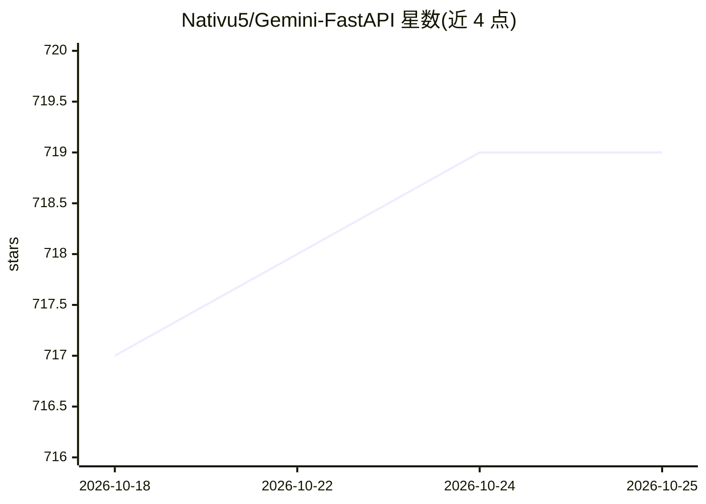

# Nativu5/Gemini-FastAPI

⭐ 719 · Python · MIT · 推送 2026-09-07 · [GitHub](https://github.com/Nativu5/Gemini-FastAPI) · 个人维护 · 中文 README

**将 Gemini 网页版封装为 OpenAI 兼容 API 的服务**

基于 FastAPI 的自托管服务：用 Gemini 网页会话 Cookie（secure_1psid/secure_1psidts）替代官方 API Key，通过逆向接口调用网页版模型，暴露 /v1/chat/completions 等 OpenAI 兼容端点，支持流式输出、多模态上传、工具调用、结构化输出与 /v1/responses 高级端点。内置 LMDB 多轮会话持久化、多账号负载均衡（按账号配代理）、临时聊天模式与超长上下文压缩策略。需 Python 3.13，提供 Docker 与 Compose 部署；README 声明使用逆向 API，可能不符合 Google 服务条款。

## 筛选速览

| 维度 | 判定 | 备注 |
|---|---|---|
| AI 角色 | `ai-ecosystem` | LLM/agent 周边工具 |
| 许可风险 | `permissive` | MIT |
| 部署形态 | `self-host` | docker 或自建部署 |
| 模型依赖 | — | README 未给出锁定关系 |
| 硬件要求 | — | 无带数字的原话,不猜 |
| 安装摩擦 | `low` | 无编译、无系统依赖或容器化 |
| 成熟度 | — | 结构信号不足 |

## 能力要点

- 无需 Google API Key，以网页 Cookie 调用 Gemini 模型
- 提供 /v1/chat/completions 等 OpenAI 兼容端点，可作 drop-in 替换
- 多账号负载均衡与按账号代理配置
- LMDB 多轮会话持久化、上下文压缩与临时聊天模式

## 适用场景

- 已有 OpenAI 客户端的应用切换到 Gemini 网页模型
- 无官方 API Key 的个人环境自建对话 API 服务
- 通过多账号分发应对请求频率限制

## 场景标签

`模型网关` · 领域:Agent 开发

## 证据(README 行号)

> L9: Web-based Gemini models wrapped into an OpenAI-compatible API. Powered by HanaokaYuzu/Gemini-API.
> L83: These endpoints are designed to be compatible with OpenAI's API structure, allowing you to use Gemini as a drop-in 

## 星数曲线

2026-10-18 717 → 2026-10-25 719（+2）

---
*卡片 v1 · prompt 1.4 · 生成 2026-10-21 · 置信度 high · 依据 README sha `a53edd10d7d3` · [字段定义](../../DATASET.md)*
