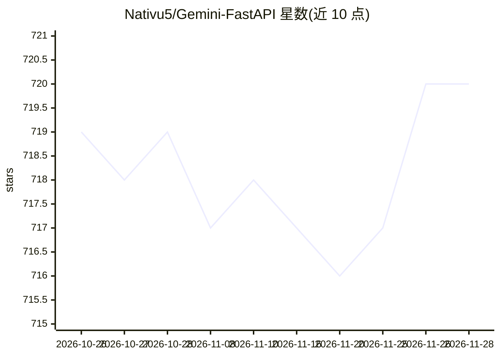

# Nativu5/Gemini-FastAPI

⭐ 720 · Python · MIT · 推送 2026-11-24 · [GitHub](https://github.com/Nativu5/Gemini-FastAPI) · 个人维护 · 中文 README

**把 Gemini 网页版封装成 OpenAI 兼容 API 的服务**

基于 FastAPI 的自托管服务，通过登录后的 Gemini 网页会话 cookie 鉴权（无需 Google API Key），将网页版模型暴露为三类 API：OpenAI Chat Completions、OpenAI Responses 与 Gemini 原生 generateContent。支持流式输出、工具调用、结构化输出、图像/文件输入与图像生成，内置网页搜索，支持多账号轮询并各自配置代理。工具调用与结构化校验在提示中请求、由服务端事后检查；temperature 等参数被接受但不生效。声明用于教育与研究目的。

## 筛选速览

| 维度 | 判定 | 备注 |
|---|---|---|
| AI 角色 | `ai-ecosystem` | LLM/agent 周边工具 |
| 许可风险 | `permissive` | MIT |
| 部署形态 | `self-host` | docker 或自建部署 |
| 模型依赖 | — | README 未给出锁定关系 |
| 硬件要求 | — | 无带数字的原话,不猜 |
| 安装摩擦 | `low` | 无编译、无系统依赖或容器化 |
| 成熟度 | — | 结构信号不足 |

## 能力要点

- 三类 API 表面均支持流式、工具调用与结构化输出
- 使用网页会话 cookie 鉴权，无需 Google API Key
- 多账号请求分发，每账号可配置独立代理
- 提供 Docker 与 Docker Compose 部署方式

## 适用场景

- 为已有 OpenAI 兼容客户端接入 Gemini 网页模型
- 本地开发中用同一套接口调用多种网页版模型
- 教育/研究场景下实验网页版模型的多模态输入输出

## 场景标签

`模型网关` · 领域:Agent 开发

## 证据(README 行号)

> L9: Web-based Gemini models wrapped into an OpenAI-compatible API. Powered by HanaokaYuzu/Gemini-API.
> L16: - **Three API surfaces**: OpenAI Chat Completions, OpenAI Responses, and Gemini-native `generateContent`.
> L143: This project is not affiliated with Google or OpenAI and is intended solely for educational and research purposes.

## 星数曲线

2026-10-26 719 → 2026-11-28 720（+1）

---
*卡片 v1 · prompt 1.4 · 生成 2026-11-26 · 置信度 high · 依据 README sha `1fbb1244f5d8` · [字段定义](../../DATASET.md)*
