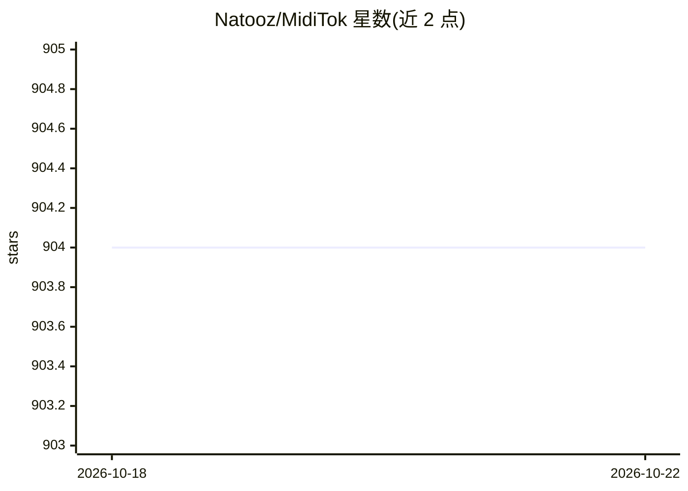

# Natooz/MidiTok

⭐ 904 · Python · MIT · 推送 2026-09-30 · [GitHub](https://github.com/Natooz/MidiTok) · [官网](https://miditok.readthedocs.io/) · 个人维护

**面向深度学习的 MIDI/符号音乐分词 Python 库**

Python 库，将 MIDI 与 abc 文件转换为可输入 Transformer 等模型的 token 序列，用于音乐生成、转录与音乐信息检索任务。实现 REMI、CPWord、TSD 等 11 种已知音乐分词方案，支持用 BPE、Unigram、WordPiece 训练分词器，并提供数据增强方法。底层用 Symusic 读写文件，BPE/Unigram 依托 Hugging Face tokenizers 加速，与 Hugging Face Hub 集成，提供 PyTorch 数据集工具类。限制：暂不支持 MusicXML 文件（在 Todos 中列出）。

## 筛选速览

| 维度 | 判定 | 备注 |
|---|---|---|
| AI 角色 | `ai-ecosystem` | LLM/agent 周边工具 |
| 许可风险 | `permissive` | MIT |
| 部署形态 | `library` | 以包/库形式分发 |
| 模型依赖 | — | README 未给出锁定关系 |
| 硬件要求 | — | 无带数字的原话,不猜 |
| 安装摩擦 | `low` | 无编译、无系统依赖或容器化 |
| 成熟度 | — | 结构信号不足 |

## 能力要点

- 实现 REMI、CPWord、MMM 等 11 种音乐 tokenization
- 支持 BPE / Unigram / WordPiece 训练分词器
- 提供 PyTorch Dataset 与 DataCollator 工具类
- 与 Hugging Face Hub 集成，BPE/Unigram 由 tokenizers 加速

## 适用场景

- 训练符号音乐生成模型前将 MIDI 转为 token
- 用 Hugging Face 模型生成音乐并复用分词方案
- 音乐信息检索任务中的符号音乐预处理与数据增强

## 场景标签

 · 领域:音乐 AI/符号音乐处理

## 证据(README 行号)

> L16: MidiTok can tokenize MIDI and abc files, i.e. convert them into sequences of tokens ready to be fed to models such 
> L17: MidiTok features most known music tokenizations (e.g. REMI, Compound Word...), and is built around the idea that th

## 星数曲线

2026-10-18 904 → 2026-10-22 904（+0）

---
*卡片 v1 · prompt 1.4 · 生成 2026-10-21 · 置信度 high · 依据 README sha `ec5002d948de` · [字段定义](../../DATASET.md)*
